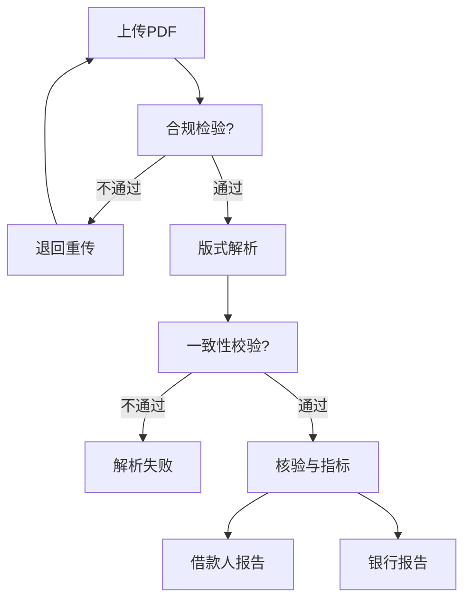

:::info
《需求分析文档》

+ 目的：就需求进行分析拆解，明确必要性、可行性、优先级。
+ 撰写者：产品经理
+ 下游使用者：产品经理、架构师。
+ 文档边界：本文只回答「做什么、为什么做、值不值得做、先做什么」，不含技术实现。技术能力依据见《资金流水分析与信贷风控技术调研》，实现方案见《产品设计文档》。
:::

# 0. 前提与范围
## 场景前提

| 项 | 设定 |
| --- | --- |
| 业务范围 | 个人（零售信贷）银行流水|
| 文件形态 | 三类：带文字层的 PDF（电子件）、JPG/PNG 或无文字层 PDF（影像件）、屏幕截图（截图件） |
| 文件排除 | 非 PDF/JPG/PNG 的格式、企业流水、手写账本 |
| 系统构成 | 对外借款人上传页 + 行内工作台，同一套系统的两个前端 |
| 报告形态 | 单份分析报告，仅银行侧可见；借款人不展示结论与指标 |
| 场景覆盖 | 授信为完整链路；资金交易安全、反电诈、反洗钱以批量筛查形态提供 |

# 1. 需求概览

## 1.1 产品定位

> 银行内部的流水分析系统：借款人在银行提供的上传页提交银行流水，系统按各行版式解析，输出含风控指标的结构化报告，分别提供给借款人与银行审批人员。系统同时支持行内数据批量导入，用于交易安全、反电诈与反洗钱的离线筛查。

## 1.2 参与方与角色

| 主体 | 角色 | 主要动作 |
| --- | --- | --- |
| 借款人 | 借款人本人 | 上传流水、查看受理状态、按提示补件 |
| 银行 | 审批人 | 查看银行版报告、导出、记录审批意见 |
| 银行 | 模板管理员 | 标注与维护版式模板、发布与停用版本 |
| 银行 | 运营管理员 | 查看使用统计、维护账号与权限 |
| 银行 | 系统管理员 | 任务监控、失败处置、系统配置 |
| 开发方 | 建设方 | 需求分析、设计、开发、交付与质保，非运行时角色 |

系统内只有两类使用者：借款人与银行员工。数据由借款人产生，处理目的与信贷决策由银行承担，开发方不持有数据。

## 1.3 主链路

**流程文字版**

1. 借款人上传 PDF。
2. 合规检验：不通过则退回重传，并说明原因。
3. 版式解析：识别版式并抽取交易明细。
4. 一致性校验：不通过则判定解析失败，不生成报告。
5. 真实核验与指标计算。
6. 输出银行侧分析报告。

## 1.4 模板资产模型

模板分两层管理，均归银行所有：

| 层 | 来源 | 维护方 | 作用 |
| --- | --- | --- | --- |
| 预置模板库 | 随系统交付预置 | 开发方交付后移交银行 | 主流银行版式开箱可用 |
| 本行模板库 | 银行员工标注 | 银行模板管理员 | 长尾银行与特殊版式 |

规则：

+ 解析时本行模板库优先于预置模板库。
+ 模板由银行提供并维护，平台按模板执行，不校验其内容正确性。
+ 模板版本长期保留，供历史年度流水解析使用。

标注对象通常是**客户带来的他行流水**，因此模板覆盖范围不限于本行版式。

# 2. 借款人侧

**用户特征**：关注隐私，单账户为主，交易频次中等，收入与消费为主要关注点，对附言摘要内容敏感（涉赌、涉网贷经历）。金融知识水平有限，行业术语理解成本高。

## 2.1 功能点矩阵

| 功能点 | 前端 | 后端 | 算法 | 数据 | 验收口径 |
| :---: | :--- | :--- | :--- | :--- | :--- |
| 文件上传与合规性检验 | 拖拽上传、进度反馈、按原因码提示退回原因、密码输入 | 接收文件流、生成任务 ID、执行合规检验 | — | 原始文件、哈希、元数据入库 | 合格文件全部进入解析；不合格文件返回可读原因 |
| 标准版式解析 | 明细表格、低置信字段标红、结果下载 | 调用解析服务、写入交易明细 | 版式识别与字段抽取 | 交易明细表 | 一致性校验通过；笔数级准确率达标 |
| 解析失败与重传 | 失败定位到页或行、一键重传 | 任务转失败态、保留原文件 | 余额反推修复 | 失败样本入库 | 失败返回定位信息；重传不重复建任务 |
| 完整性校验与补传 | 缺月提示、补传入口 | 期数、页码、合计行、账户覆盖校验 | 月份缺口检测 | 材料清单状态 | 准确输出缺失月份；补传后任务可续 |
| 真实性证据核验 | 五态结论与证据展示 | 编排证据、存证 | 一致性校验与语义规则 | 证据包 | 每条结论可追溯至规则与交易 |

## 2.2 必要性分析

流水是证明还款能力的主要材料，且由借款人自行提供，上传是整条链路的唯一数据入口。

+ 缺少合规性检验：不合规文件进入解析，用户获得的是「解析失败」而非具体原因，问题无法在入口收敛。
+ 缺少完整性校验：申请人可只提交有利时段与账户，后续指标在算术上仍然成立，但不再反映真实收支水平。
+ 缺少真实性证据核验：系统输出未经验证的结论，在无鉴定能力的条件下风险由使用方承担。
+ 报告向借款人开放：借款人看到判定口径后会针对性调整材料，形成反向选择；结论只对银行可见，借款人只看到受理状态与补件要求。

## 2.3 可行性分析

+ 合规性检验：读取 PDF 结构（魔数、trailer、加密状态、文字层），单个开源库可完成，无需样本训练。
+ 一致性校验：纯算术，输入为解析结果本身，不依赖外部数据，是唯一不依赖人工标注的质量判定手段。
+ 文字层解析：按字符坐标重建行列具备成熟实现，风险集中在跨页表格与无边框表格。
+ 指标计算：口径确定后为聚合运算，主要风险是口径分歧而非技术实现（见 R1）。
+ 前端：React + Vite + ECharts，能力满足。

# 3. 银行侧

**用户特征**：分三类使用者。审批人关注结论可信度与可复核性；模板管理员关注版式维护效率；运营与系统管理员关注解析量、任务状态与账号权限。

## 3.1 审批工作台

| 功能点 | 前端 | 后端 | 算法 | 数据 | 验收口径 |
| :---: | :--- | :--- | :--- | :--- | :--- |
| 银行版报告查看 | 报告列表、详情、证据跳转原页 | 权限校验、报告聚合 | — | 报告快照 | 仅可见授权范围 |
| 报告导出 | PDF 导出、水印 | 导出任务、导出留痕 | — | 导出审计日志 | 每次导出可追溯 |
| 审批留痕 | 意见录入、历史意见 | 保存审批意见 | — | 审批记录 | 意见与报告版本绑定 |
| 权限与脱敏 | 字段级掩码 | 角色权限、脱敏规则 | — | 权限配置 | 未授权字段不出现在前端 |

**必要性**

+ 缺少证据跳转：审批人只能看到结论，无法核对原始流水，报告不具备实际使用价值。
+ 缺少导出留痕：报告离开系统后失去管控，无法追溯导出人与导出批次。
+ 缺少权限与脱敏：完整卡号与证件号在审批链路扩散，构成合规风险。

**可行性**

+ 证据跳转：报告结论已挂载交易 ID 与原始页码，前端定位属展示层工作。
+ 导出与留痕：常规能力，写入审计记录即可。
+ 权限模型：角色为审批人、模板管理员、运营管理员、系统管理员，RBAC 可覆盖。

## 3.2 模板管理

| 功能点 | 前端 | 后端 | 算法 | 数据 | 验收口径 |
| :---: | :--- | :--- | :--- | :--- | :--- |
| 模板标注与版式管理 | 原件预览、字段框选、标注预览 | 模板增删改查、样本原件存储 | — | 本行模板库 | 由银行操作，产物即生效版本 |
| 模板版本管理 | 版本列表、启用与停用 | 版本管理、版本切换 | — | 模板版本记录 | 历史版本可随时切换 |

**必要性**

+ 缺少标注工具：客户带来的他行流水版式不受本行控制，只能依赖通用解析，准确率不可控。
+ 缺少版本管理：银行更新版式后，历史月份无法用当时版本解析。

**可行性**

+ 模板标注：PDF 预览与字段框选为成熟交互，作业规范要求以银行原件为标注依据。
+ 版本管理：模板定义为结构化数据，版本表即可实现。

## 3.3 运营与系统管理

| 功能点 | 前端 | 后端 | 算法 | 数据 | 验收口径 |
| :---: | :--- | :--- | :--- | :--- | :--- |
| 规则配置 | 规则列表、灰度、回滚 | 规则版本化 | — | 规则库 | 可回滚至任一历史版本 |
| 任务监控 | 任务列表、失败明细、一键重跑 | 状态查询、重跑 | — | 任务日志 | 失败任务可一键重跑 |
| 数据看板 | 解析量、失败率、风险分布、下钻 | 聚合接口 | — | 统计宽表 | 指标口径与报告一致 |
| 账号与权限管理 | 用户与角色维护 | 账号、角色、授权 | — | 权限配置 | 角色变更即时生效 |

**必要性**

+ 缺少任务监控：解析失败无法及时发现。
+ 缺少规则配置：规则调整依赖发版，运营效率受研发排期限制。
+ 缺少看板：版式覆盖与解析质量的运行状况不可观测。
+ 缺少账号管理：多角色共用账号，操作无法归因。

**可行性**

+ 规则配置与版本管理：结构化配置，无需算法。
+ 数据看板：解析量与失败率可由任务表聚合，无需额外埋点。
+ 账号与权限：标准 RBAC，与审批工作台共用权限模型。

# 4 核心引擎

以下能力被两侧共同调用，无独立界面，单列以避免重复描述。

## 4.1 能力矩阵

| 能力 | 输入 | 处理 | 输出 | 验收口径 |
| :---: | :--- | :--- | :--- | :--- |
| 合规性检验 | 原始材料 | 载体判定、类型、完整性、加密、分辨率、清晰度、页数、来源单一性 | 通过 / 不通过及原因码 | 原因码覆盖全部退回场景，无静默失败 |
| 解析引擎 | 合规 PDF | 版式识别、字段抽取、通用解析兜底 | 结构化交易明细 | 一致性校验通过率达标 |
| 一致性校验 | 解析结果 | 余额链、合计行、笔数、期初期末四项算术校验 | 通过 / 失败及异常定位 | 可定位至具体行 |
| 真实性核验 | 解析结果与模板 | 证据采集与规则判定 | 五态结论与证据包 | 结论可回溯至规则与交易 |
| 指标计算 | 交易明细 | 按口径计算指标 | 指标集（含指标集版本与单项口径版本） | 相同输入得到相同输出；数量可增减 |

## 4.2 必要性分析

五项能力分别对应入口拦截、结果自证与结论可担责。三者不含界面功能，缺少任一项则上层报告缺少可信度支撑。

---

# 5 优先级安排

| 级别 | 内容 | 目标 |
| :---: | :--- | :--- |
| **P0** | 文件上传、合规性检验、任务 ID | 合法文件可上传可追踪，不合规文件被拦截并说明原因 |
| **P1** | 标准版式解析、一致性校验 | 国有行与股份行标准版式跑通，解析结果可自证；笔数级准确率 >99% |
| **P2** | 完整性校验、补传、解析失败重传 | 材料质量形成闭环，缺失项可定位可补 |
| **P3** | 文件层与内容层核验 | 假件与账实不符可被识别，结论可定位 |
| **P4** | 账务层与外部层核验、五态结论 | 输出分层证据与五态结论，不作鉴定 |
| **P5** | 分析报告、导出、留痕 | 支持复核、导出与责任追溯 |
| **P6** | 模板标注与发布、模板版本管理 | 长尾银行流水可由本行自行沉淀为模板 |
| **P7** | 数据看板、任务监控、规则配置、账号管理 | 系统可观测、可运营、可运维 |

**排序依据**：入口校验与结果自证优先（P0–P1），材料质量闭环次之（P2），报告与银行侧能力随后（P3–P5），规模化与运维能力最后（P6–P7）。合规性检验与上传同批交付：未经检验的文件直接进入解析，会放大错误传播范围。

# 6 非功能需求

| 类别 | 要求 | 备注 |
| --- | --- | --- |
| 开发框架 | 前端 React + Vite；后端 FastAPI | 已定 |
| 外部依赖 | 抽取调行内 OCR/解析服务 | 服务不可用时任务失败可重跑，不静默降级 |
| 阈值 | 系统给默认阈值，银行可改，记版本 | 结论按阈值给出提示，不改真伪结论 |
| 并发 | 任务创建接口 ≥100 QPS | 不含解析与分析算力负载 |
| 延迟 | 电子件 ≤5s、影像件 ≤8s（均 P99） | 基准为 ≤10 页且 ≤300 笔；影像件含 OCR |
| 准确率 | 解析字段准确率 >99% | 以笔数级为主口径，辅以「金额合计与文件合计行一致」；字段级与整份级为辅助抽查 |
| 安全 | 展示脱敏、导出留痕、操作可审计 | 具体字段与加密层级待定 |
| 部署 | 银行侧部署，数据不出行 | 部署形态待定 |
| 兼容 | 主流浏览器最近两个大版本 | — |

# 7 待调研清单

| # | 调研问题 | 影响 |
| --- | --- | --- |
| **R1** | 风控指标标准口径：月均收入、收入稳定性、负债率、消费能力的计算方式与剔除规则 | 指标与报告内容 |
| **R2** | 各银行流水版式差异：字段、合计行、页脚、印章特征 | 模板库与解析规则 |
| **R3** | 行业对虚假流水的认定与处理惯例 | 真实性五态的表述边界 |
| **R4** | 贷款审批对流水覆盖期与新鲜度的常规要求 | 时效性阈值 |
| **R5** | 解析准确率的行业验收口径（字段级 / 笔数级 / 文档级） | 验收标准 |
| **R6** | 风控报告在银行的实际使用形态 | 银行版报告结构 |
| **R7** | 余额不连续的合理例外（跨账户、系统调整、结息舍入） | 余额校验容差 |
| **R8** | 流水中的敏感字段与脱敏规则 | 报告脱敏与留存 |

# 附录 A 业务问题与处置

| 问题 | 归属侧 | 处置 |
| :---: | :---: | :--- |
| 上传真实性 | 借款人 | 限定官方导出件；输出五态证据，不作鉴定 |
| 上传完整性 | 借款人 | 输出缺失月份；允许补传 |
| 账户归属 | 借款人 | 不采集用户输入；自动抽取后与实名比对，冲突时才请求确认 |
| 时效性 | 借款人 | 纳入校验，仅作提示不作阻断 |
| 文件可用性与密码 | 借款人 | 合规性检验前置；口令输入 |
| 不认同结果 | 借款人 | 措辞规约、申诉入口、报告版本化 |
| 解析失真 | 银行 | 四项一致性校验；校验不通过不出报告 |
| 无可用模板 | 银行 | 本行标注工具自建模板；预置模板与通用解析兜底 |
| 余额连续性 | 银行 | 逐笔余额链与期初期末等式；可用于反推纠错 |
| 非标准件 | 借款人 | 提示重传，不做图像增强 |
| 冷启动 | 银行 | 限定首批银行范围，长尾靠标注补充 |
| 指标口径 | 银行 | 口径版本化；数据不足返回空值 |
| 可解释性 | 借款人 | 零认知门槛，按图表与措辞规约执行 |
