# 智能风控 · 银行流水分析系统 产品设计文档

:::info
**文档定位**：把《需求分析文档》的需求翻译成可开发的产品方案。
**上游依据**：《需求说明文档》《需求分析文档》《资金流水分析与信贷风控技术调研》。
**下游使用**：前后端开发、测试、交付。
**文档边界**：写模块、流程、架构、模型、接口契约；不写具体代码实现与算法细节。
:::

## 0. 文档定位与边界

| 项 | 说明 |
| --- | --- |
| 甲方 | 银行 |
| 乙方 | 开发方 |
| 系统归属 | 部署于银行侧，交付后归银行所有与运维 |
| 本文回答 | 系统由哪些模块组成、业务怎么流转、数据怎么建模、接口怎么约定 |
| 本文不回答 | 算法实现细节、部署脚本、性能调优参数 |

**图示约定**：不使用菱形判断节点，判断改用矩形加问号，分支语义由连线标签承担。全文二十张图，每张图后跟一段文字。图负责结构与分支，文字负责三件事——这张图在解决什么问题、判断依据是什么、异常怎么落。只读图不看文字会丢掉判断理由，只读文字不看图会丢掉先后顺序。

---

## 1. 产品定位与目标用户

### 1.1 一句话定位

> 部署在银行内部的流水分析系统：借款人在银行提供的上传页提交流水，系统核验材料、抽取交易、计算指标，输出借款人版与银行版两份报告。

### 1.2 用户与场景

| 用户 | 场景 | 核心诉求 |
| --- | --- | --- |
| 借款人 | 提交材料、看自己的报告 | 看得懂、能申诉 |
| 银行审批人 | 复核证据、出审批意见 | 结论可追溯、能担责 |
| 银行模板管理员 | 补长尾版式 | 不依赖外部就能自己加 |
| 银行运营与系统管理员 | 看运行状况、配规则、管账号 | 可观测、可干预 |

四类风控场景的覆盖方式不同：授信走完整链路，资金交易安全、反电诈、反洗钱走批量筛查。

### 1.3 需求来源与裁决

| 来源 | 例子 | 裁决原则 |
| --- | --- | --- |
| 需求说明文档（甲方原始） | 借款人页面、银行工作人员管理页面 | 原文优先，不擅自增删 |
| 需求分析文档（本项目） | 双版本报告、三态结论 | 无原文依据时以本文为准 |
| 技术调研（可行性） | 印章不作真伪判定 | 技术边界优先于业务期望 |

冲突时按「技术边界 > 需求分析 > 原始说明」的顺序裁决，并在第 10 节记录。

---

## 1. 整体设计

### 1.1 产品功能模块

系统由四个前台模块与一个引擎模块组成：

| 模块 | 面向 | 主要功能 |
| --- | --- | --- |
| 借款人端 | 借款人 | 上传、进度、借款人版报告、申诉 |
| 银行工作台 | 审批人 | 报告查看、证据跳转、导出、审批留痕 |
| 银行管理台 | 模板管理员与运营 | 模板标注与发布、规则配置、任务监控、看板、账号 |
| 批量筛查 | 风控与合规岗 | 行内数据导入、规则筛查、清单输出 |
| 分析引擎 | 内部 | 解析、校验、核验、指标、规则 |

功能模块之间的调用关系：

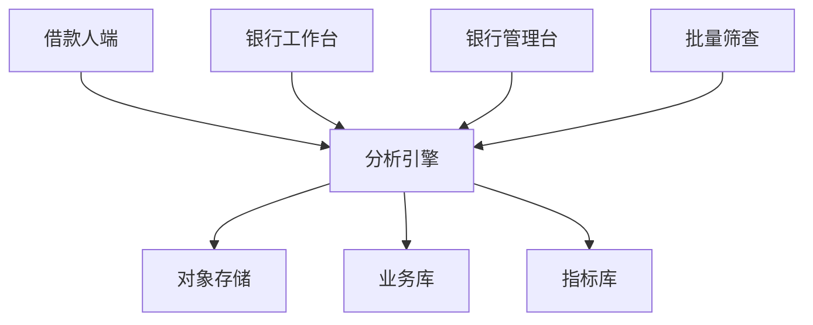

四个前台模块都只经由应用层调用引擎，不直连数据库；引擎的统一输出回写到对象存储与业务库。这样新增一个前台（例如合规岗的筛查台）不需要改动引擎，代价是权限与审计必须在应用层收口。

### 1.2 业务主流程

业务主流程按「材料能不能用、数据对不对、结论可不可信」三件事组织，分成一张全景与五条业务线。全景里把两个检验的判据直接画出，避免出现只有名字没有内容的空框。

#### 1.2.1 全景

主链三步：把文件变成明细、把明细变成结论、把结论变成报告。

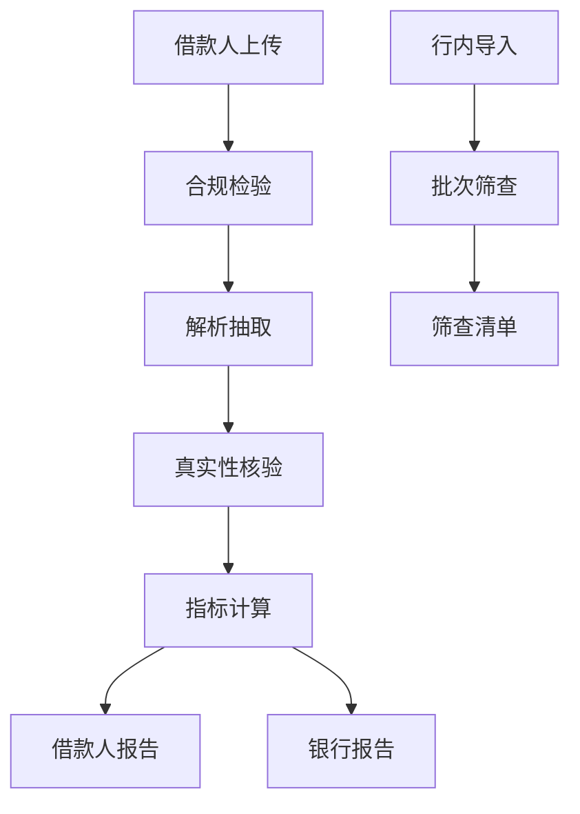

真实性核验内部包含三项检查，其中数字核对（四项算术）只是其中一项，不单独成阶段。理由在 2.2.4 说明。

#### 1.2.2 支撑业务

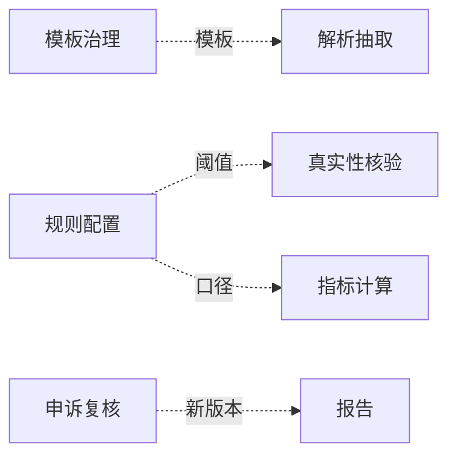

| 支撑线 | 供什么 | 断了会怎样 |
| --- | --- | --- |
| 模板治理 | 版式与字段映射 | 解析退回通用兜底，准确率下降 |
| 规则配置 | 校验阈值与指标口径 | 判断失去标准，结果不可比 |
| 申诉复核 | 新版本报告 | 结论无法纠正，机制失效 |

三条与主链是横向依赖，画进主链会让箭头交叉成网，所以单独成图。

#### 1.2.3 材料受理

产物是**可用于分析的交易明细**，标准只有一条：这份明细能不能拿去做分析。它不给材料定性，也不判断真假。

系统里有两类输入，信任等级不同，处理方式也不同：

| 输入 | 提供方 | 信任等级 | 处理 |
| --- | --- | --- | --- |
| 模板、规则、利率表 | 银行 | 高，直接采用 | 不校验，只监测版式是否变更 |
| 流水文件 | 借款人 | 默认不可信 | 合规检验、真实性核验、三态结论 |

对银行侧不做二次判断，对借款人侧必须核验——这不是双标，是因为前者是行内权威，后者是被评价方自己提交的材料。

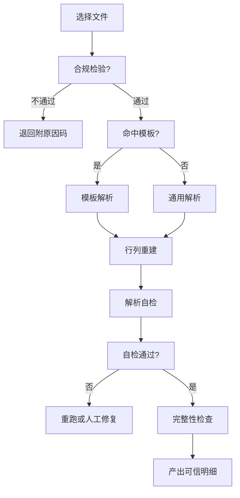

合规检验五项，任一不通过即退回：

| 判据 | 不通过的含义 | 怎么判断 |
| --- | --- | --- |
| 格式 | 不是 PDF | 读文件头魔数 |
| 完整 | 文件被截断 | 读 trailer 与 EOF |
| 加密 | 有口令未提供 | 读加密字典 |
| 文字层 | 不是官方导出件 | 是否含可提取文本 |
| 单一来源 | 混装多家银行 | 比对页眉与表头 |

**文字层不是文件质量判据，而是来源判据**：官方导出的 PDF 必然带文字层，没有只可能来自截图、翻拍、扫描或二次打印。

**解析自检**回答的是「我们抽对了没有」，与材料真假无关：

| 指标 | 判据 | 不达标意味着 |
| --- | --- | --- |
| 字段完整率 | 必填字段非空比例 | 有列没识别出来 |
| 平均置信度 | 各行抽取置信度均值 | 版式识别偏了 |
| 低置信行占比 | 置信度低于阈值的行数占比 | 局部有问题，可定位 |

不达标就重跑或转人工，不进入后面的核验。这三项是纯工程指标，用来衡量这一次解析是否达到可用标准。

完整性四类缺失，检测得到但无法强制客户补全：

| 缺失 | 判定手段 | 业务后果 | 处置 |
| --- | --- | --- | --- |
| 缺页 | 实收页数少于页脚总页数 | 漏掉整段收支 | 退回补传 |
| 缺月 | 考察期内整月无交易 | 收入被高估 | 退回补该月 |
| 缺账户 | 声明账户数多于解析账户 | 隐瞒他行负债 | 要求声明 |
| 缺合计行 | 文件中无合计行 | 无法对账 | 标注后继续 |

#### 1.2.4 真实性核验

这是唯一给材料定性的环节。它由三项检查组成，三者的信息源不同、证据强度不同，最后合成为一个三态结论。

**流程**

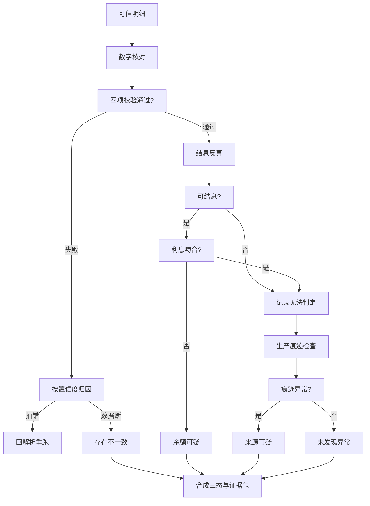

**三步分别在做什么**

| 步骤 | 检查 | 信息从哪来 | 失败说明什么 |
| --- | --- | --- | --- |
| 一、数字核对 | 余额链、合计行、笔数、期初期末 | 文件自己的数据 | 数字对不上，需先归因是抽错还是数据断 |
| 二、结息 | 结息反算 | 银行利率表与计息规则 | 余额历史与应得利息不符 |
| 三、生产痕迹 | 文件结构、字体、增量更新 | 文件的生成过程 | 这份文件不像官方系统产出 |

第一步用文件验证文件，是数字核对；第二步第一次跳出文件，用银行规则验证；第三步看文件怎么被生产出来的。

**判定与处置**

| 数字核对 | 结息 | 痕迹 | 结论 | 处置 |
| --- | --- | --- | --- | --- |
| 失败且归因为数据断 | — | — | 存在不一致 | 停止，不出报告 |
| 通过 | 偏差超容差 | — | 余额可疑 | 停止，标注余额与结息不符 |
| 通过 | 吻合或不可算 | 异常 | 来源可疑 | 继续，报告中明示 |
| 通过 | 吻合 | 正常 | 未发现异常 | 正常进入分析 |
| — | 不可算 | 正常 | 未发现异常但标注 | 报告中说明核验不完整 |

证据包随结论一起产出，每条结论挂规则编码与命中的交易，审批人可跳回原始页码。

#### 1.2.5 模板维护

模板由银行提供并维护，平台按模板执行，**不对模板做任何质量判断**。

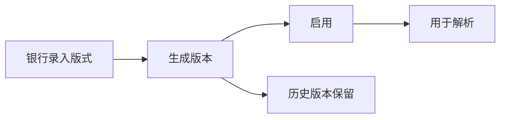

| 动作 | 谁做 | 说明 |
| --- | --- | --- |
| 录入 | 银行模板管理员 | 提供字段与坐标映射 |
| 生成版本 | 系统 | 每次录入产生新版本，只增不改 |
| 启用 | 银行 | 新版本启用后用于后续解析 |
| 历史保留 | 系统 | 旧版本永久保留，供历史月份解析 |

平台不采集模板的解析表现，不做灰度、不做回滚判断。某版式若不适用，由银行自行更新；平台只负责按当前启用版本执行。

#### 1.2.6 批量筛查

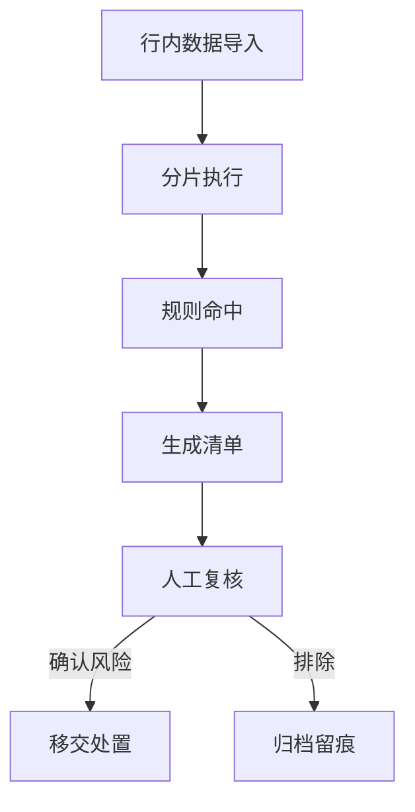

服务资金交易安全、反电诈与反洗钱三类场景。平台只出清单，不执行冻结或报送——处置动作由行内系统与业务人员承担，这是边界，不是能力不足。

#### 1.2.7 异议申诉

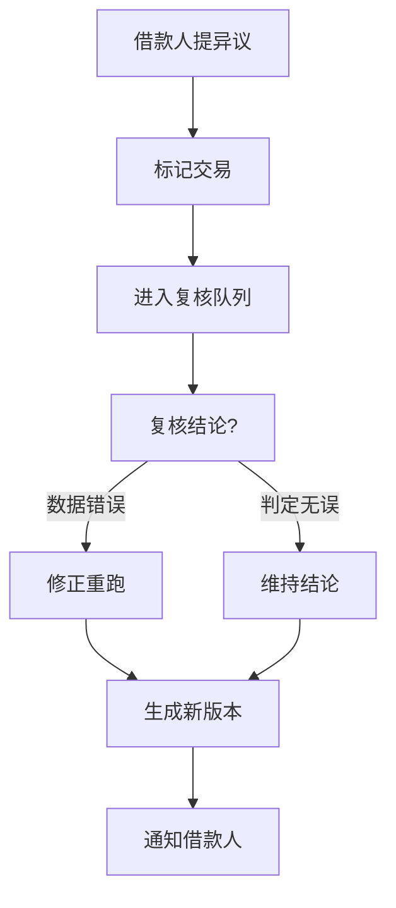

借款人只能对具体交易提异议，不能对整体结论提异议。复核后无论是否修改都生成新版本，原版本保留——版本可追溯是申诉机制成立的前提。

### 1.3 技术架构图

#### 1.3.1 分层架构

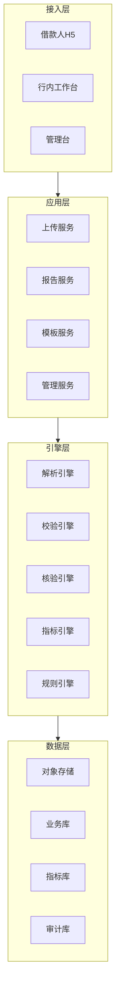

四层单向依赖，下层不反向调用上层。接入层不做业务判断，应用层不做算法计算，引擎层不感知界面，这三条是硬约束，越界会直接导致后续无法替换。

分层原则：接入层不写业务判断，应用层不做算法计算，引擎层不感知界面。

#### 1.3.2 部署拓扑

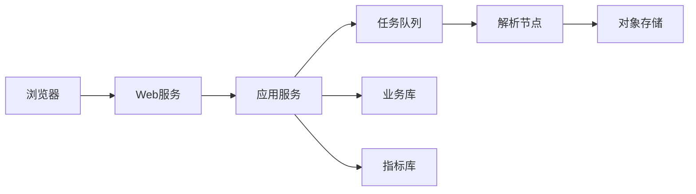

单机或少量节点部署，不引入反向代理与负载均衡。课程项目的并发量远达不到需要它们的程度，加了只会增加部署复杂度与排障成本；真要上生产时再补这一层，不影响现有结构。

外网上传与行内数据导入走不同入口，中间件与存储都在内网。解析节点可水平扩展，因为解析是全链路最耗时的环节。

### 1.4 时序决策图

本节只放时序图。图中的 alt 块就是该环节真正做出的决策，判据在第二章已说明，此处只标注决策发生在哪一步、由谁拍板。

#### 1.4.1 上传与合规检验

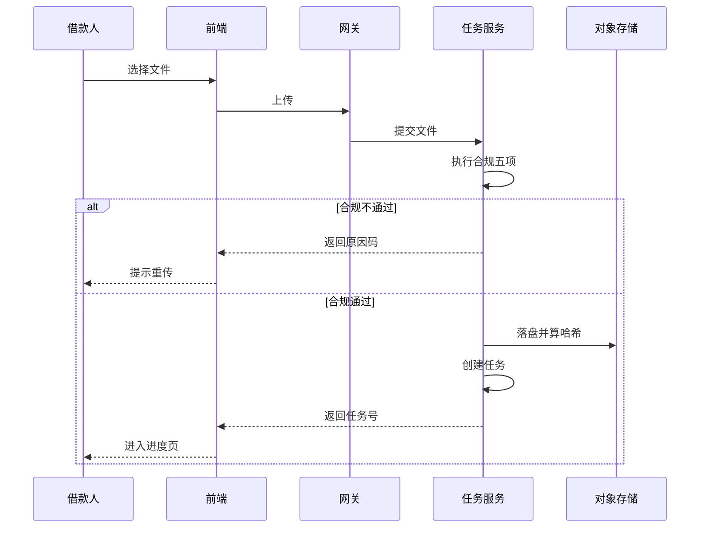

决策点是合规五项的合并判断，全部在任务服务内完成，前端只负责展示原因码。

#### 1.4.2 解析与自检

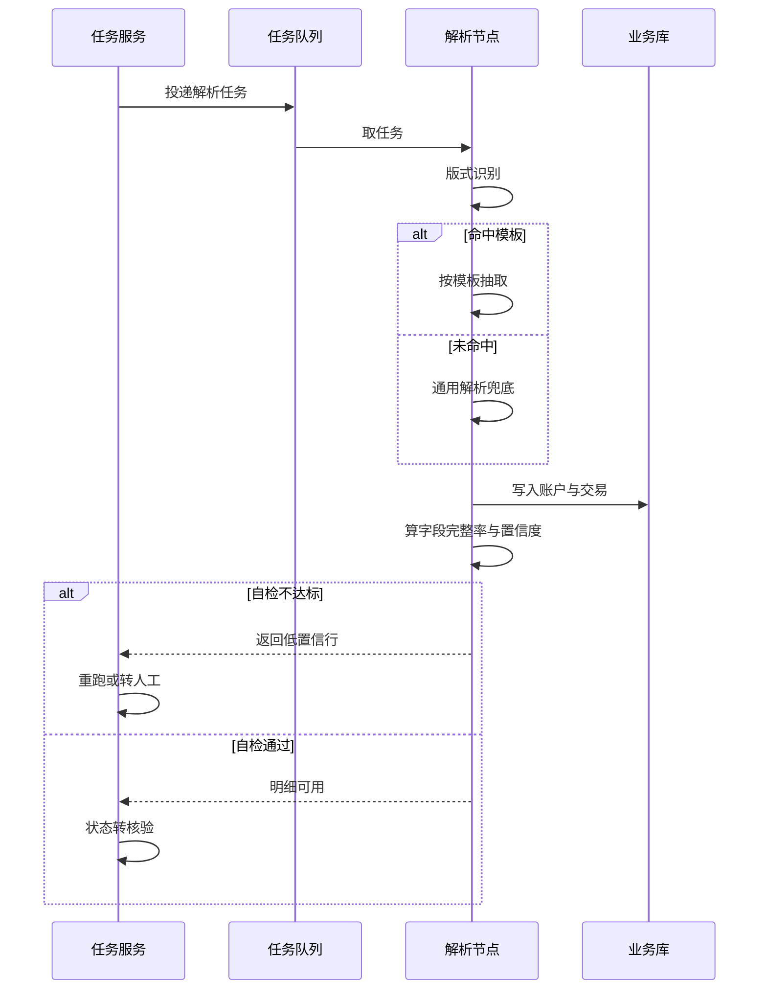

两个决策点：模板命中与否只影响抽取方式；自检是否达标决定任务继续还是返工。自检看的是字段完整率、平均置信度、低置信行占比三项，纯工程指标，与材料真假无关。

#### 1.4.3 核验与报告生成
