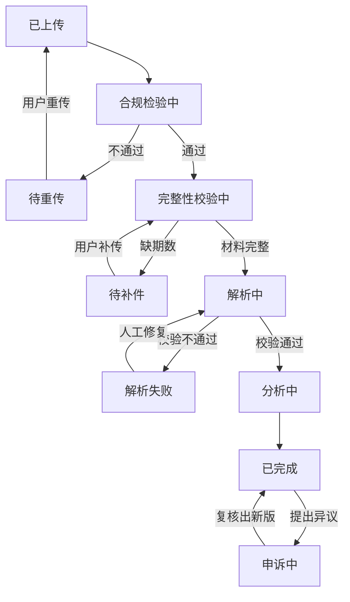
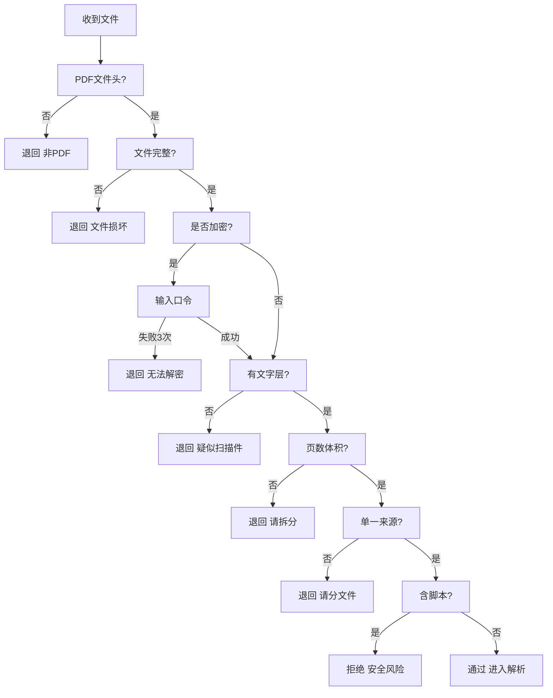
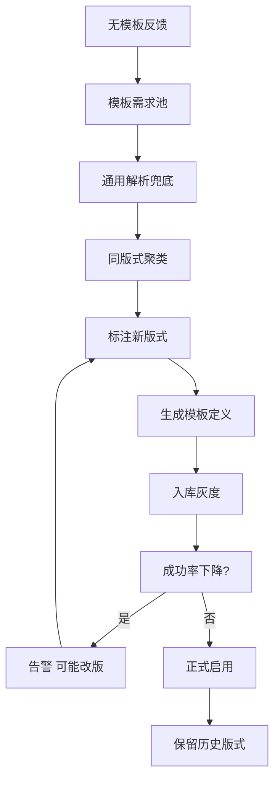

# 方案设计素材（从需求分析 v2 拆出）

> 来源：tmp/需求分析文档_v2_完整存档.md。本文件只存**设计向**内容，供后续撰写《产品设计文档》（九段范式）使用。

## 一、业务流程图素材：任务状态机

## 二、合规性检验的判定顺序

## 三、模板治理闭环

## 四、可解释性规约（前端交互设计用）

原则：面向借款人，假设用户零认知门槛。

1. 不用行业词：变异系数、对手方、勾稽、环比一律不出现。
2. 三级渐进：一句话总结 → 三个要点 → 展开明细。
3. 每条结论配证据：点得开"你的哪几笔"。
4. 用相对量："比上个月少了一半"，不用 "-50%"。
5. 不吓人也不哄人：陈述事实 + 给建议，不写"疑似欺诈"。
6. 术语浮层：每个可能看不懂的词都有"这是什么"。
7. 失败也说人话："文件里没有可读文字，可能是扫描件"，不是 ERROR_1003。

反例 → 正例：
+ 反例：近 6 个月收入变异系数 0.62，判定为收入不稳定（中风险）
+ 正例：你的收入起伏比较大：6 个月里有 2 个月进账不到 5 千，其余月份都在 1 万以上。（查看这 2 个月）

## 五、术语口径（全项目通用，勿混用）

| 术语 | 含义 | 归属 |
| --- | --- | --- |
| 流水版式 | 某银行某渠道导出的 PDF 长什么样 | 解析用 |
| 解析模板 | 针对一种版式的字段抽取定义 | 解析用 |
| 报告模板 | 输出报告的排版样式 | 输出用，平台自有 |
| 解析规则 / 风控规则 | 两类规则，不可混称 | — |

## 六、页面与角色映射（前端交互设计用）

| 主体 | 角色 | 页面 |
| --- | --- | --- |
| 借款人 | 借款人本人 | 上传页 / 报告页 / 申诉页 |
| 银行 | 审批人 | 报告列表 / 报告详情 |
| 银行 | 运营管理员 | 账号与权限 / 使用统计 |
| 银行 | 模板管理员 | 模板标注工作台 / 模板版本 |
| 银行 | 运营管理员 | 账号与权限 / 使用统计 |
| 银行 | 系统管理员 | 任务监控 / 规则配置 / 数据看板 |