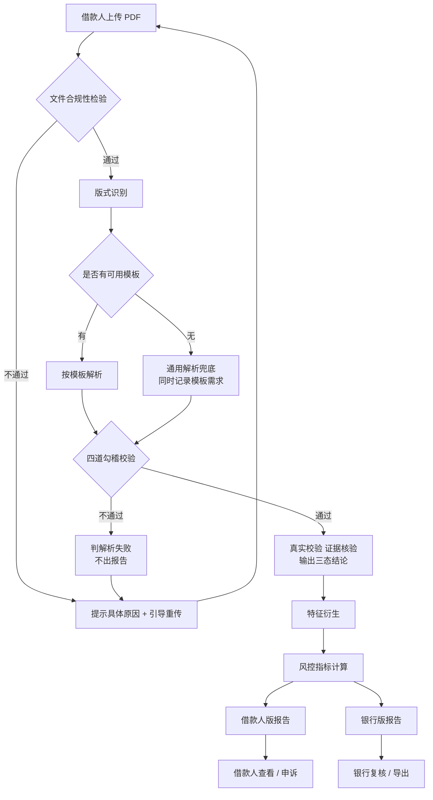
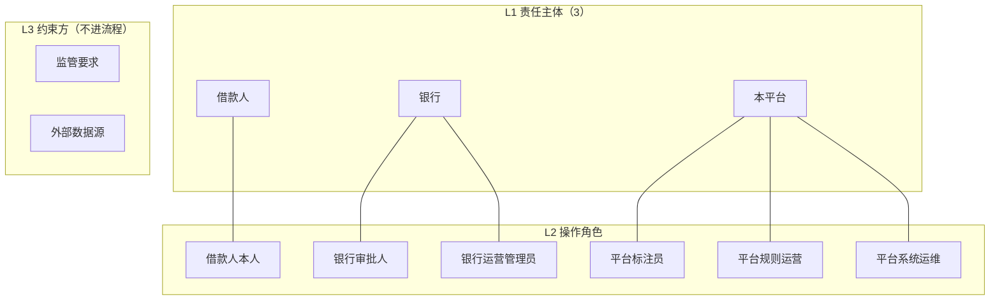
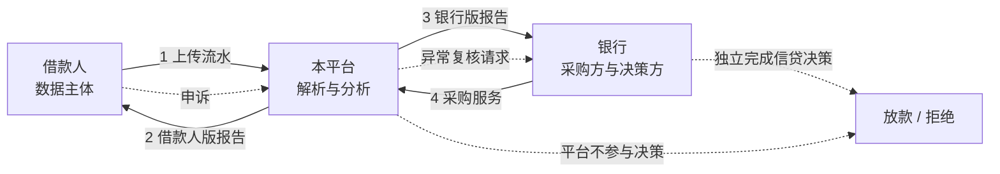
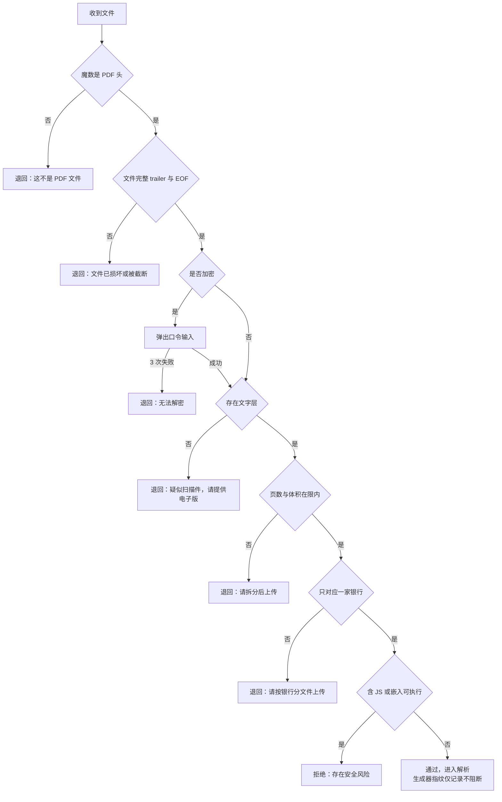
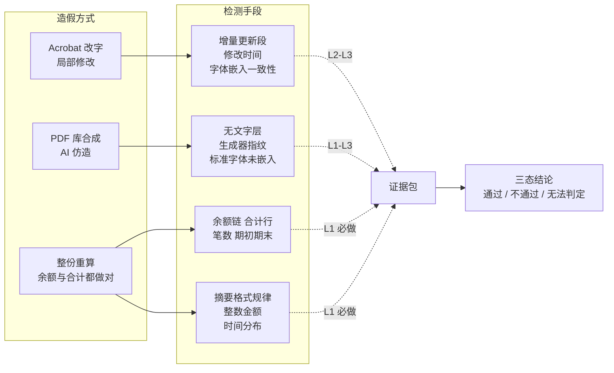
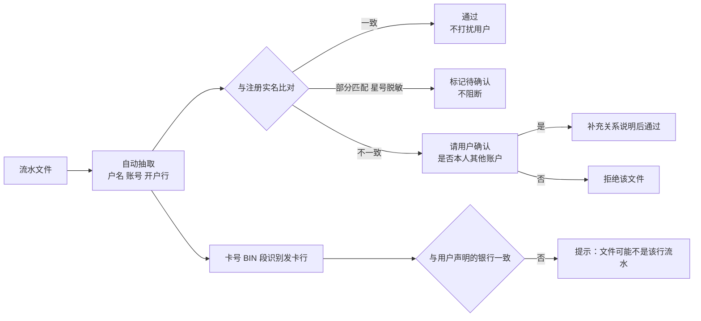
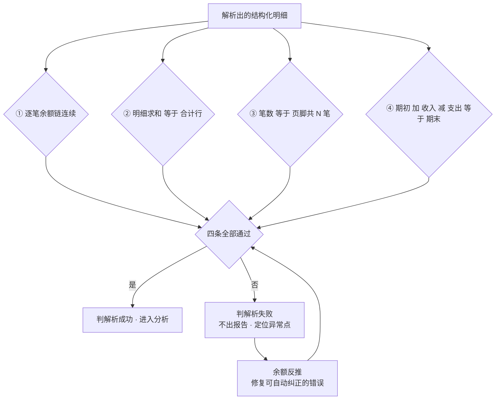
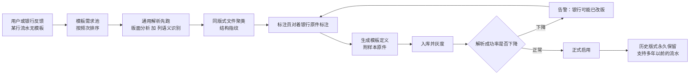
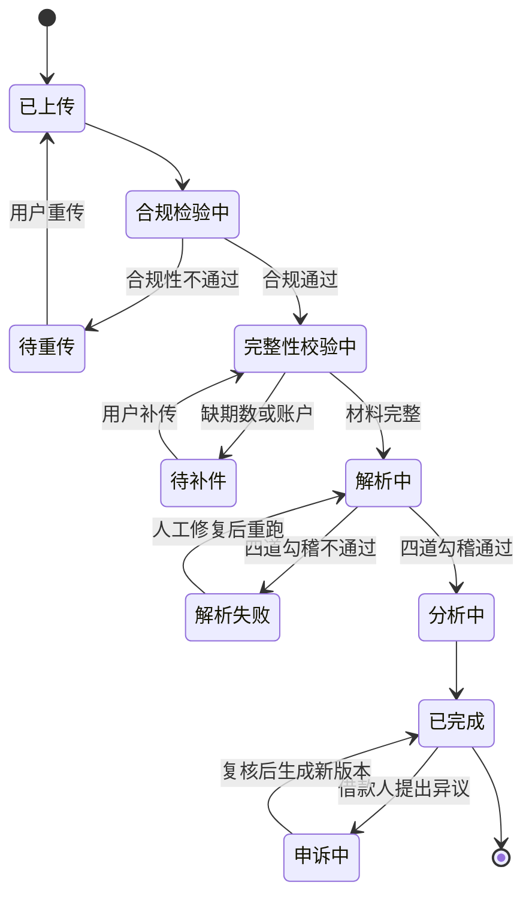
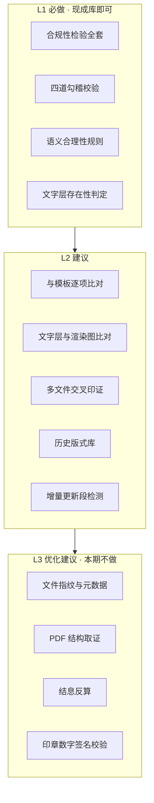

# 智能风控 · 银行流水解析平台

## 需求分析文档 v2（协作重写稿）

:::info
**本稿说明**
+ 与根目录 `需求分析文档.md`（另一 Agent 所写，1327 行）并存，**不覆盖原文件**，便于对比取舍。
+ 写作方式：逐章讨论 → 逐章定稿。每章标注「已决 / 待决」。
+ 项目性质：课程/学习项目，面向"理解风控业务"，取舍上**优先业务实质**，弱化获客、计费、法务细则。
:::

---

### 0. 协作状态

| 章节 | 状态 | 定稿轮次 |
| --- | --- | --- |
| 1. 产品定位 | 已决 | R1–R2 |
| 2. 参与方与权责 | 已决 | R1–R2 |
| 3. 业务问题与解法 | 已决 | R3–R6 |
| 4. 端到端业务流程 | 待启动 | — |
| 5. 功能需求 | 待启动 | — |
| 6. 指标与报告内容 | 待启动 | — |
| 7. 真实校验（四要素） | 延后 | — |
| 8. 非功能需求 | 待启动 | — |
| 9. 验收标准 | 待启动 | — |

**场景已定**

| 已定 | 未定 |
| --- | --- |
| 只收**完好 PDF**，不收截图、纸质、翻拍 | 一次申请传几份流水（单账户还是多账户） |
| 独立平台入口，借款人自己上传 | 是否支持多年前的历史流水 |
| 报告两份（借款人版 / 银行版） | 用户注册与实名方式 |
| 面向个人零售信贷，银行采购 | 银行侧账号形态 |

**本期明确不做**

+ 不做"客户经理邀请链接 / 任务码 / 归属绑定"链路 —— 借款人直接注册、直接上传。
+ 不做多租户隔离与计费方案。
+ 不建风控模型，只做特征衍生与规则，特征本期只入库。
+ 不做图像取证类手段（ELA、压缩痕迹），因为不接截图与纸质。

---

## 1. 产品定位

### 1.1 一句话定位

> 一个独立的第三方流水解析平台：借款人在平台侧上传银行流水，平台按各行版式自动解析，输出含个人风控指标的结构化报告，分别提供给借款人与采购方银行。

### 1.2 要解决的现状问题

传统流水分析没有自动化系统，全靠人工，痛点有二：

1. **流水是非结构化文档**（PDF、图片、纸质扫描），人工逐笔录入与核对，效率低、易出错。
2. **风险判断依赖专家经验**，不同人看同一份流水结论不同，存在识别盲区，无法标准化。

平台要做的就是把这两件事分别产品化：**解析自动化** + **风险判断规则化**。

### 1.3 边界

| 做 | 不做 |
| --- | --- |
| 个人（零售信贷）银行流水的解析 | 对公 / 企业流水（已废弃方向） |
| 按行版式识别与字段抽取 | 代银行做信贷决策 |
| 真实性的**证据核验**（三态结论） | "真伪鉴定"（鉴定权不在平台） |
| 风控指标计算与解释 | 输出"建议放款 / 拒绝"的决策结论 |
| 两份报告生成与导出 | 对接银行核心系统的自动审批 |

### 1.4 产品形态

+ 平台是**独立入口**，不是内嵌在银行 App 里的后台能力。
+ 借款人在平台自己的页面完成注册、上传、查看报告。
+ 银行作为**采购方 / 使用方**消费解析结果与报告。

### 1.5 端到端主链路



### 1.6 报告形态：**两份**

| | 借款人版 | 银行版 |
| --- | --- | --- |
| 读者 | 借款人本人 | 银行审批/风控人员 |
| 内容 | 个人流水画像：收支结构、稳定性、异常项、改善建议 | 完整特征明细、贷审相关指标、异常证据链 |
| 不含 | 贷审结论、银行内部口径、评分等级 | — |

**为什么必须分两份**：若借款人版等同银行版，平台输出的措辞会直接变成纠纷来源；同时两份共享同一套底层特征，成本增量很小。

另一层原因：**指标算法本身是资产**。规则一旦对借款人全量公开，用户会照着刷流水（制造"稳定工资"、刷高余额）。所以借款人版必须做**信息减法**。

### 1.7 核心资产：模板库与规则库

+ **模板库**：各银行流水的真实版式，随银行改版持续演进，**历史版式永久保留**。
+ **规则库**：解析规则（版式适配、字段映射、校验）与风控规则（指标计算、异常判定）分开管理。

### 1.8 术语口径（先统一，否则后面必吵）

| 术语 | 含义 | 归属 |
| --- | --- | --- |
| **流水版式** | 某银行某渠道导出的 PDF 长什么样（表头、列序、合计行、印章位置） | 解析用 |
| **解析模板** | 针对一种版式的字段抽取定义 | 解析用 |
| **报告模板** | 输出报告的排版样式 | 输出用，平台自有 |
| **规则** | 解析规则 / 风控规则两类，不可混称 | — |

> "模板"一词在本项目中有两种截然不同的含义，文档中一律加限定语（流水版式 / 报告模板）。

---

## 2. 参与方与权责

### 2.1 三层模型



### 2.2 三方定位

| 主体 | 在流程中 | 业务权责 |
| --- | --- | --- |
| **借款人** | 提供流水、接收报告 | 数据主体。对上传材料的真实性负责 |
| **银行** | 采购服务、消费报告、做信贷决策 | 决策权与最终判断权在银行。平台只提供证据与指标 |
| **本平台** | 解析、核验、分析、出报告 | 对解析准确率、指标口径、报告一致性负责；不得越权下结论 |

> 三方的权责不对称：借款人不付费，但上传行为在借款人侧；银行付费但不产生数据；平台不拥有数据但要为加工质量负责。**"谁产生数据、谁付钱、谁担责"三者是错位的**，这是本项目最需要在文档里说清的一点。

### 2.3 三方数据流



### 2.4 操作角色

| 主体 | 角色 | 主要动作 |
| --- | --- | --- |
| 借款人 | 借款人本人 | 注册、上传、查看借款人版报告、申诉 |
| 银行 | 审批人 | 查看银行版报告、导出、记录审批意见 |
| 银行 | 运营管理员 | 维护本行版式清单、查看使用统计 |
| 平台 | 标注员 | 对着银行原件标注新版式、补充样本 |
| 平台 | 规则运营 | 维护解析规则与风控规则、灰度与回滚 |
| 平台 | 系统运维 | 任务监控、失败重跑、容量与告警 |

### 2.5 权责矩阵

| 事项 | 借款人 | 银行 | 平台 |
| --- | --- | --- | --- |
| 上传什么流水 | 决定 | 提要求 | 校验完整性 |
| 解析结果对不对 | 可申诉 | 可复核 | **负责** |
| 真实性结论 | 可查看 | 可查看 | **只出证据与三态** |
| 是否放款 | 无关 | **决定** | 不参与 |
| 指标口径 | 可理解 | 可提要求 | **负责定义** |
| 报告措辞 | 影响体验 | 影响使用 | **负责** |

---

## 3. 业务问题与解法

### 3.1 场景前提

| 项 | 本期设定 |
| --- | --- |
| 文件形态 | **只收"完好"的标准 PDF**：银行电子渠道导出、带文字层、可复制、无密码或用户可提供口令 |
| 明确不收 | 截图、拍照、纸质扫描、翻拍屏幕 —— 合规性检验阶段直接退回，**提示重传** |
| OCR 定位 | 降级为异常件兜底，**不再是主链路** |
| 场景性质 | 课程模拟场景，资源有限，样本可能为合成或陈旧数据 → 部分校验做成"可配置、默认提示不阻断" |

> **范围收窄的红利**：AI 仿造件很难生成"结构正确"的银行 PDF，因此许多取证手段变得可行且成本低。

### 3.2 文件合规性检验（入口闸门）

所有文件进入解析前必须先过这道闸。输出「通过 / 不通过 + 原因码」，原因码直接映射到人话提示（"这份文件是加密的，请输入密码"，而不是 ERROR_1003）。



| 检查项 | 判定要点 | 不通过处理 |
| --- | --- | --- |
| 文件类型 | 魔数 `%PDF-`，**扩展名不作数**（改后缀的图片在此被抓） | 提示重传 |
| 文件完整 | trailer / EOF 存在，未被截断 | 提示文件损坏 |
| 加密状态 | 无密码，或用户输入口令后可解（银行常用身份证后 6 位） | 弹口令输入，3 次失败退回 |
| 文字层 | 至少一页可提取到非空文本 | 判为扫描件，提示提供电子版 |
| 页数/体积 | 不超过上限 | 提示拆分 |
| 单一来源 | 一个文件只对应一家银行 | 提示分文件上传 |
| 安全性 | 无 JS、无嵌入可执行、无外部链接 | 拒绝 |
| 生成器指纹 | Producer / Creator / 字体嵌入情况 | **仅记录不阻断**，交真实性检查 |

### 3.3 用户侧六题

#### 3.3.1 真实性

**先按造假方式分，再按检测手段配** —— 不同的假，破法不同。



**（A）Acrobat / 编辑器改字留下的痕迹**

| 痕迹 | 怎么查 | 成本 |
| --- | --- | --- |
| **增量更新** | 文件末尾出现第二个 `%%EOF`（Acrobat 保存就是追加一段） | 极低 |
| 修改日期不符 | CreationDate 与 ModDate 不一致 | 极低 |
| 生成器变了 | Producer 从银行报表系统变成 Adobe Acrobat | 极低 |
| 字体不一致 | 银行件字体全部嵌入子集，改字会新增未嵌入字体 | 低 |
| 视觉与文字层不符 | 渲染成图再比对文字层 | 中 |

**（B）AI 仿造（PDF 库合成 / 图生 PDF）**

| 特征 | 说明 |
| --- | --- |
| 无文字层，或文字层是 OCR 出来的 | 字的存储顺序混乱、一字一对象 |
| Producer 是 reportlab / fpdf / weasyprint / Chrome | 一查即知 |
| 字体是 Helvetica、Times 且未嵌入 | 银行件从不这么干 |
| 元数据几乎为空 | AI 工具不写 XMP |
| 无电子印章签名域 | 真件常带 |

> **关键**：因为只收"完好 PDF"，**AI 生成件在第一道闸就会被挡掉大半**。这是范围收窄换来的最大红利。

**（C）数学勾稽 —— 不依赖任何造假知识，永远有效**

详见 3.4.1。四条：余额链、合计行、笔数、期初期末。造假者想把四条同时做对，等于把整份流水重算一遍。

**（D）语义合理性 —— 纯规则，无需训练**

摘要格式的规律性（"跨行转出-张三-尾号1234" 格式漂移即可疑）、整数金额占比异常、时间分布（凌晨 2 点连刷）、收入支出比例不合理。

> **业务侧配套**：只收官方渠道导出件；一次性签署《材料真实性承诺》（与隐私协议合并，**不逐步勾选**）；人工抽检；多银行流水交叉印证；平台只出三态，不出"真伪鉴定"。

#### 3.3.2 完整性

**业务解法**

+ 明确上传标准：**≥6 个月、覆盖全部账户、含合计行**。
+ **声明合并为一次**：注册时签完，之后上传不再逐步勾选协议。
+ 不合格当场退回，**写明缺哪几个月**（"你缺 2024 年 9 月、10 月"，不是"材料不完整"）。
+ **允许补传**：任务不作废，进入「待补件」，原文件保留，补传后合并再重算。

**技术解法**

+ 期数连续性：从明细按月聚合交易日期，找缺口。
+ 页码连续：读页脚「第 X 页 / 共 Y 页」。
+ 合计行与明细求和比对。
+ 期初 + 收支 = 期末。
+ 账户覆盖：从封面抽账号，多账户只解析出一个 → 有漏。
+ 时间跨度：最晚与最早交易日之差 ≥ 6 个月。

#### 3.3.3 账户归属

**结论：不让用户填户名。**



**为什么不让用户填**：流水里本来就有户名、账号、开户行——**采集不需要用户输入**。需要判断的不是"这份流水属于谁"（流水自己写着），而是"**它是不是当前申请人本人的**"，这要跟注册时已有的实名信息比对，**也不需要用户再填**。

所以正确形态是：**系统自动抽取 → 自动比对 → 只在冲突时打扰用户**。用户唯一会看到的场景是："这份流水户名是李四，与你的实名信息不一致，是否为你本人的其他账户？"

**唯一现实坑**：银行流水户名常脱敏（例如"张星三"显示为"张星号三"），技术上只能部分匹配。这一点必须由业务先让步（接受部分匹配）或改走人工，技术自己定不了。

#### 3.3.4 时效性

**行业惯例（检索所得）**：贷款普遍要求 3–6 个月流水，房贷常见 6 个月；银行不认"快进快出、即存即取"和"自存流水"；手机银行可打印 5 年内明细。

**结论：纳入，但降级为提示项。**

1. **两个维度别混**：**覆盖期长度**（要 6 个月）属完整性；**新鲜度**（截止日距今多少天）才是时效性。
2. 技术上取「交易日期最大值」与申请日相减，成本极低。
3. 但**样本可能是旧数据**，硬校验会全员不通过 → 做成**可配置 + 默认只提示不阻断**：报告上写"流水截止 2024-03-31，距申请日 128 天"，让银行判断。

**连带影响（重要）**：手机银行能打 5 年明细，意味着用户**可能传几年前的流水**，而银行版式每年在变 → **模板库必须保留历史版式，不能只留最新版**，否则去年的流水今天解析不了。

#### 3.3.5 文件可用性与密码

见 3.2 合规性检验。补充两点：

+ **密码是真实高频场景**：银行导出 PDF 常用身份证后 6 位加密。处理方式是弹口令输入，3 次失败退回，**不做暴力破解**。
+ **失败提示必须说人话**："这份文件里没有可读文字，可能是扫描件，请从手机银行重新导出"，而不是 ERROR_1003。

#### 3.3.6 不认同结果

**业务解法**：措辞规约（只陈述观察、不下判定）+ **申诉入口** + 答复时效承诺。

**技术解法**：证据链（结论 → 规则 ID → 交易 ID → 原件页坐标）；异议标注双轨（用户标注不覆盖原始解析结果）；报告版本化（申诉后出新版，旧版留档）；指标可回溯。

### 3.4 平台侧七题

#### 3.4.1 解析失真

**定义：PDF 上写的是 A，平台解析出来的结构化数据是 B。**

原件这一行：

```text
2024-03-15 | 工资代发 | +12,345.00 | 98,765.00
```

可能的失真结果：

| 类型 | 解析结果 | 后果 |
| --- | --- | --- |
| 方向翻转 | 收入被解析成支出 | 余额链立刻崩 |
| 精度丢失 | 12345 / 1234.5 | 金额错，合计对不上 |
| 列错位 | 摘要里的 20240101 被当成日期 | 日期全乱 |
| 行拆分 | 一条交易被拆成两条 | 笔数虚增 |
| 字符混淆 | 0/O、1/l、5/S | 对手方或金额错 |
| 整页丢失 | 少了第 7 页 | 笔数少一截 |

**PDF 特有的坑**：PDF 里文字的**存储顺序不等于视觉顺序**。上面那一行内部可能存成"2024-03-15"、"98,765.00"、"工资代发"、"+12,345.00" 四个互不相邻的对象，视觉位置全靠坐标。所以解析器必须**按坐标重建行列**，不能按存储顺序读——这是电子 PDF 解析最容易翻车的地方，也是"完好 PDF"不等于"好解析"的原因。

**失真不需要人眼看，系统能自证**：



**规矩：对不上账就不出报告，不允许"解析成功但有几笔错"。** 这是业务规则，技术替代不了。

**与准确率的关系**：准确率 = 1 − 失真率。失真率可定义在**字段级 / 笔数级 / 文档级**三个层次，三者验收结果差异很大（调研项 R5）。

#### 3.4.2 无可用模板

**原则：模板标注的唯一真理是银行侧的模板。** 标注员不能凭"我觉得应该是这样"来标，必须对着银行真实导出件标，每份标注产物都附原件样本。



+ **反馈通道**：用户或银行可报"这是 X 银行流水，模板没覆盖"，全部进需求池，按频次排序。
+ **通用解析保底**：版面分析找表格区域 + 列语义识别（表头关键词匹配日期/摘要/借方/贷方/余额），先能跑出东西。
+ **模板有版本**：银行改版后旧模板不删，进「历史版式库」。
+ **失效要能感知**：同一版式解析成功率突降 → 触发告警。

#### 3.4.3 余额连续性

**主要是技术解法**（业务侧只保留一条：不连续要在报告里标出来，不能默默算了）。

+ 两条等式：期初 + 收入合计 − 支出合计 = 期末；上笔余额 + 本笔金额 = 本笔余额。
+ 容差 0.01 元；同一秒多笔按序处理。
+ 断点定位到具体行，前端高亮。
+ **反向修复**：某笔金额错一位导致余额对不上，余额可反推正确金额 —— 这是余额连续性最大的价值，不只是校验，是纠错。

#### 3.4.4 非标准件

**只提示重传。** 不做图像增强、不做复杂兜底。合规性检验不通过就退回，附具体原因 + 重传指引。

#### 3.4.5 冷启动

**仅作考量项，本文不展开。** 只记录一条风险：首批必须限定银行范围，长尾靠人工。

#### 3.4.6 指标口径

转入**调研需求**（见 3.7）。已确定的工程约束：

+ 口径必须版本化，并绑定报告版本；口径变了历史报告不能悄悄变。
+ 数据不足返回空值 + 原因码，**绝不默认 0**（默认 0 会算出"收入 0 元"的假结论）。

#### 3.4.7 可解释性

**原则：面向借款人，假设用户零认知门槛。**

七条规约：

1. **不用行业词**：变异系数、对手方、勾稽、环比 —— 一律不出现。
2. **三级渐进**：一句话总结 → 三个要点 → 展开明细。
3. **每条结论配证据**：点得开"你的哪几笔"。
4. **用相对量**："比上个月少了一半"，不用 "-50%"。
5. **不吓人也不哄人**：陈述事实 + 给建议，不写"疑似欺诈"。
6. **术语浮层**：每个可能看不懂的词都有"这是什么"。
7. **失败也说人话**："文件里没有可读文字，可能是扫描件"，不是 ERROR_1003。

> **反例 → 正例**
> 反例：近 6 个月收入变异系数 0.62，判定为收入不稳定（中风险）
> 正例：你的收入起伏比较大：6 个月里有 2 个月进账不到 5 千，其余月份都在 1 万以上。（查看这 2 个月）

### 3.5 任务状态机



### 3.6 实现分层



| 层级 | 手段 | 说明 |
| --- | --- | --- |
| **L1 必做** | 合规性检验全套；余额链、合计行、笔数、期初四道勾稽；摘要格式规律性检查；整数金额、时间分布等语义规则 | 不依赖训练、不依赖标注数据 |
| **L2 建议** | 与模板逐项比对（表头、列序、页脚、水印位置）；文字层与渲染图比对；多文件交叉印证；历史版式库；增量更新段检测 | 依赖模板库积累 |
| **L3 优化建议** | 文件指纹与元数据；PDF 结构取证；结息反算；印章签名校验 | 加分项。其中**增量更新段检测成本最低**，建议提到 L2 |

### 3.7 调研需求清单

| # | 调研问题 | 影响什么 |
| --- | --- | --- |
| **R1** | 风控指标的标准口径：月均收入、收入稳定性、负债率、消费能力怎么算，剔除规则有哪些 | 指标章节、报告内容 |
| **R2** | 各银行流水版式差异：字段、合计行、页脚、印章特征 | 模板库、解析规则 |
| **R3** | 行业对"假流水"的认定与处理惯例 | 真实性三态怎么表述 |
| **R4** | 贷款审批对流水覆盖期与新鲜度的常规要求 | 时效性阈值（已初步查到 3–6 个月） |
| **R5** | 解析准确率的行业验收口径（字段级 / 笔数级 / 文档级） | 验收标准 |
| **R6** | 风控报告在银行的实际使用形态 | 银行版报告结构 |
| **R7** | 余额不连续的合理例外（跨账户、系统调整、结息四舍五入） | 余额校验容差 |
| **R8** | 流水中的敏感字段与脱敏规则 | 报告脱敏、数据留存 |

**R1 与 R5 最要紧** —— 一个决定报告里有什么，一个决定"做完没有"。

---

:::tip
**给读者的提示**：本稿每一次讨论只推进一章。第 4 章「端到端业务流程」尚未开始。
:::
