# 智能风控 · 银行流水分析系统 产品设计文档

:::info
**文档定位**：把《需求分析文档》的需求翻译成可开发的产品方案。
**上游依据**：《需求说明文档》《需求分析文档》《资金流水分析与信贷风控技术调研》。
**下游使用**：前后端开发、测试、交付。
**文档边界**：写模块、流程、架构、模型、接口契约；不写具体代码实现与算法细节。
:::

## 0. 文档定位与边界

| 项 | 说明 |
| --- | --- |
| 甲方 | 银行 |
| 乙方 | 开发方 |
| 系统归属 | 部署于银行侧，交付后归银行所有与运维 |
| 本文回答 | 系统由哪些模块组成、业务怎么流转、数据怎么建模、接口怎么约定 |
| 本文不回答 | 算法实现细节、部署脚本、性能调优参数 |

**图示约定**：不使用菱形判断节点，判断改用矩形加问号，分支语义由连线标签承担。全文二十张图，每张图后跟一段文字。图负责结构与分支，文字负责三件事——这张图在解决什么问题、判断依据是什么、异常怎么落。只读图不看文字会丢掉判断理由，只读文字不看图会丢掉先后顺序。

---

## 1. 产品定位与目标用户

### 1.1 一句话定位

> 部署在银行内部的流水分析系统：借款人在银行提供的上传页提交流水材料（PDF 或图片），系统判定载体、核验材料、抽取交易、计算指标，输出银行侧分析报告，借款人不展示结论。

### 1.2 用户与场景

| 用户 | 场景 | 核心诉求 |
| --- | --- | --- |
| 借款人 | 提交材料、看自己的报告 | 看得懂、能申诉 |
| 银行审批人 | 复核证据、出审批意见 | 结论可追溯、能担责 |
| 银行模板管理员 | 补长尾版式 | 不依赖外部就能自己加 |
| 银行运营与系统管理员 | 看运行状况、配规则、管账号 | 可观测、可干预 |

四类风控场景的覆盖方式不同：授信走完整链路，资金交易安全、反电诈、反洗钱走批量筛查。

### 1.3 需求来源与裁决

| 来源 | 例子 | 裁决原则 |
| --- | --- | --- |
| 需求说明文档（甲方原始） | 借款人页面、银行工作人员管理页面 | 原文优先，不擅自增删 |
| 需求分析文档（本项目） | 单份报告、五态结论、阈值判定 | 无原文依据时以本文为准 |
| 技术调研（可行性） | 印章不作真伪判定 | 技术边界优先于业务期望 |

冲突时按「技术边界 > 需求分析 > 原始说明」的顺序裁决，并在第 10 节记录。

---

## 2. 整体设计

### 2.1 产品功能模块

系统由四个前台模块与一个引擎模块组成：

| 模块 | 面向 | 主要功能 |
| --- | --- | --- |
| 借款人端 | 借款人 | 上传、进度、补件 |
| 银行工作台 | 审批人 | 报告查看、证据跳转、导出、审批留痕 |
| 银行管理台 | 模板管理员与运营 | 模板标注与发布、规则配置、任务监控、看板、账号 |
| 批量筛查 | 风控与合规岗 | 行内数据导入、规则筛查、清单输出 |
| 分析引擎 | 内部 | 解析、校验、核验、指标、规则 |

功能模块之间的调用关系：

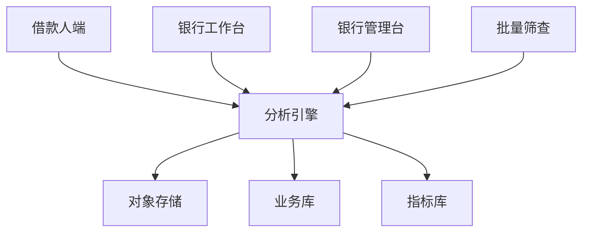

四个前台模块都只经由应用层调用引擎，不直连数据库；引擎的统一输出回写到对象存储与业务库。这样新增一个前台（例如合规岗的筛查台）不需要改动引擎，代价是权限与审计必须在应用层收口。

### 2.2 业务主流程

业务主流程按「材料能不能用、数据对不对、结论可不可信」三件事组织，分成一张全景与五条业务线。全景里把两个检验的判据直接画出，避免出现只有名字没有内容的空框。

#### 2.2.1 全景

主链三步：把文件变成明细、把明细变成结论、把结论变成报告。

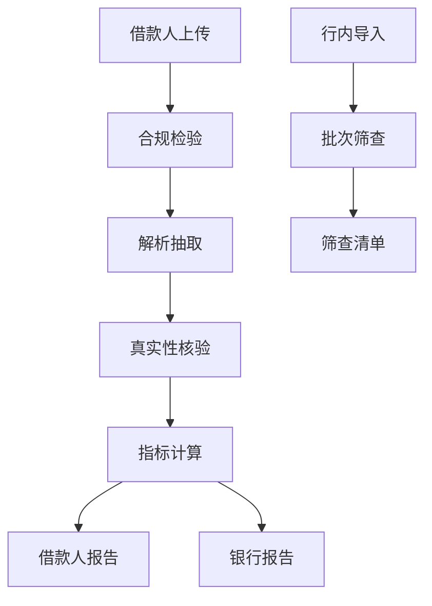

真实性核验内部包含三项检查，其中数字核对（四项算术）只是其中一项，不单独成阶段。理由在 2.2.4 说明。

#### 2.2.2 支撑业务

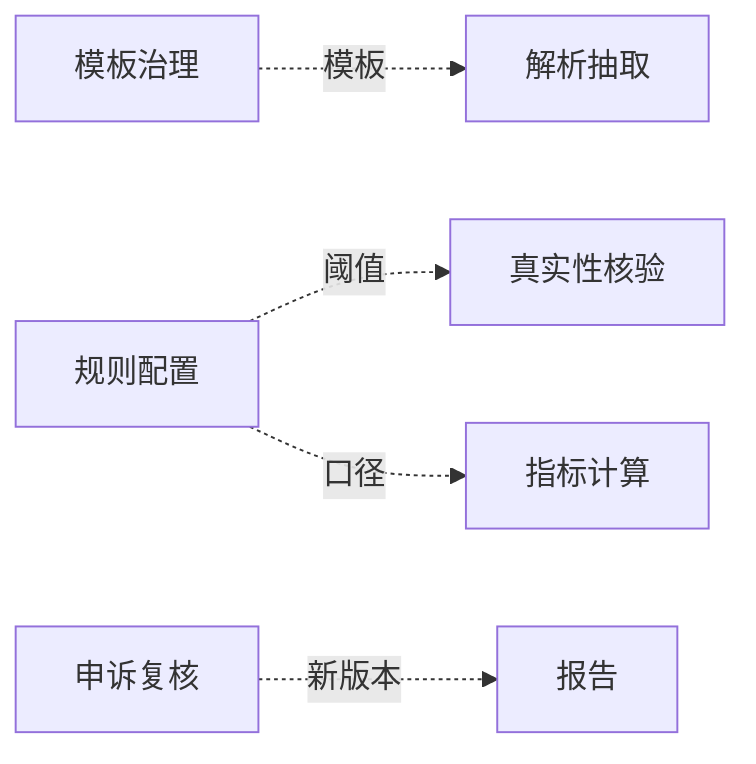

| 支撑线 | 供什么 | 断了会怎样 |
| --- | --- | --- |
| 模板治理 | 版式与字段映射 | 解析退回通用兜底，准确率下降 |
| 规则配置 | 校验阈值与指标口径 | 判断失去标准，结果不可比 |
| 申诉复核 | 新版本报告 | 结论无法纠正，机制失效 |

三条与主链是横向依赖，画进主链会让箭头交叉成网，所以单独成图。

#### 2.2.3 材料受理

产物是**可用于分析的交易明细**，标准只有一条：这份明细能不能拿去做分析。它不给材料定性，也不判断真假。

系统里有两层输入，信任等级不同，处理方式也不同：

| 输入 | 提供方 | 信任等级 | 处理 |
| --- | --- | --- | --- |
| 模板、规则、利率表 | 银行 | 高，直接采用 | 不校验，只监测版式是否变更 |
| 流水材料 | 借款人 | 默认不可信 | 载体判定、合规检验、真实性核验、五态结论 |

材料本身有三种载体，可信程度与能做的核验完全不同：

| 载体 | 判据 | 能做什么 | 结论上限 |
| --- | --- | --- | --- |
| 电子件 | PDF 且能提取文字 | 结构取证 + 内容核对 + 账务核对 | 未发现异常 |
| 影像件 | 图片，或无文字层 PDF | 图像取证 + OCR + 内容核对 + 账务核对 | 未发现异常，标注核验受限，强制人工复核 |
| 截图件 | 纯色背景、无噪点、含状态栏 | 图像取证 + OCR + 内容核对 | 来源可疑，不得作为授信依据 |

载体由服务端判定，不采信客户端自称——否则标注一下扩展名就能绕过结构取证。

对银行侧不做二次判断，对借款人侧必须核验——这不是双标，是因为前者是行内权威，后者是被评价方自己提交的材料。

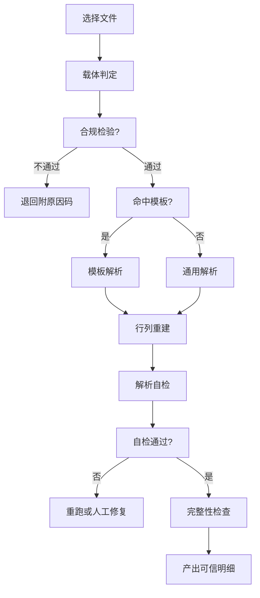

合规检验五项，任一不通过即退回：

| 判据 | 不通过的含义 | 怎么判断 |
| --- | --- | --- |
| 格式 | 不是 PDF | 读文件头魔数 |
| 完整 | 文件被截断 | 读 trailer 与 EOF |
| 加密 | 有口令未提供 | 读加密字典 |
| 载体可识别 | 判不出是电子件还是影像件 | 是否 PDF、能否提取文字 |
| 单一来源 | 混装多家银行 | 比对页眉与表头 |

**文字层不再是退回依据，而是分流依据**：有文字层走电子件路径，做结构取证；没有文字层走影像件路径，做图像取证加 OCR。两条路的结论强度不同，报告要写明。**截图件**另立一类：受理但结论封顶为来源可疑，不得作为授信依据。

**解析自检**回答的是「我们抽对了没有」，与材料真假无关：

| 指标 | 判据 | 不达标意味着 |
| --- | --- | --- |
| 字段完整率 | 必填字段非空比例 | 有列没识别出来 |
| 平均置信度 | 各行抽取置信度均值 | 版式识别偏了 |
| 低置信行占比 | 置信度低于阈值的行数占比 | 局部有问题，可定位 |

不达标就重跑或转人工，不进入后面的核验。这三项是纯工程指标，用来衡量这一次解析是否达到可用标准。

完整性四类缺失，检测得到但无法强制客户补全：

| 缺失 | 判定手段 | 业务后果 | 处置 |
| --- | --- | --- | --- |
| 缺页 | 实收页数少于页脚总页数 | 漏掉整段收支 | 退回补传 |
| 缺月 | 考察期内整月无交易 | 收入被高估 | 退回补该月 |
| 缺账户 | 声明账户数多于解析账户 | 隐瞒他行负债 | 要求声明 |
| 缺合计行 | 文件中无合计行 | 无法对账 | 标注后继续 |

#### 2.2.4 真实性核验

这是唯一给材料定性的环节。它由三项检查组成，三者的信息源不同、证据强度不同，最后合成为一个五态结论。

**流程**

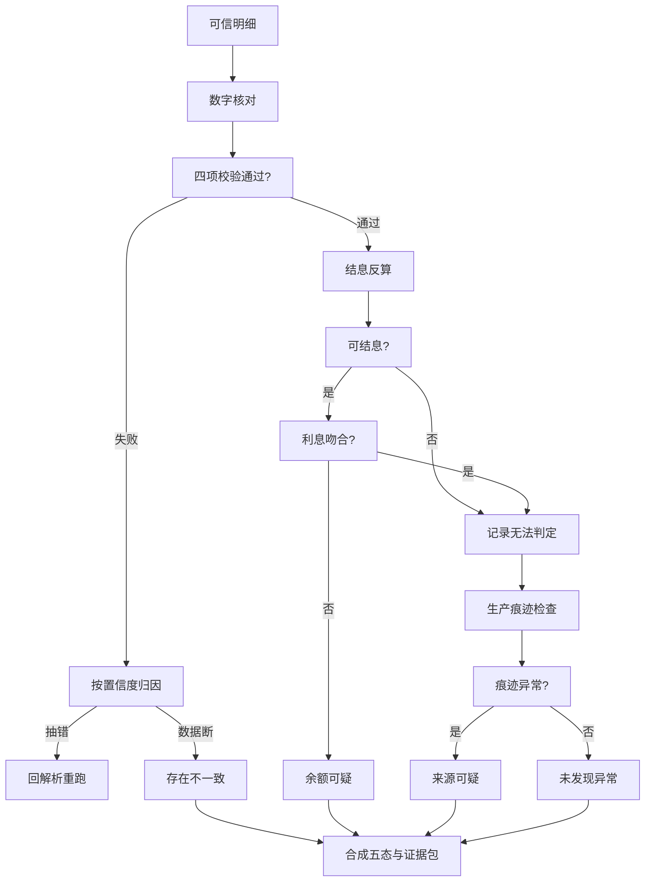

**三步分别在做什么**

| 步骤 | 检查 | 信息从哪来 | 失败说明什么 |
| --- | --- | --- | --- |
| 一、数字核对 | 余额链、合计行、笔数、期初期末 | 文件自己的数据 | 数字对不上，需先归因是抽错还是数据断 |
| 二、结息 | 结息反算 | 银行利率表与计息规则 | 余额历史与应得利息不符 |
| 三、生产痕迹 | 文件结构、字体、增量更新 | 文件的生成过程 | 这份文件不像官方系统产出 |

第一步用文件验证文件，是数字核对；第二步第一次跳出文件，用银行规则验证；第三步看文件怎么被生产出来的。

**判定与处置**

| 数字核对 | 结息 | 痕迹 | 结论 | 处置 |
| --- | --- | --- | --- | --- |
| 失败且归因为数据断 | — | — | 存在不一致 | 停止，不出报告 |
| 通过 | 偏差超容差 | — | 余额可疑 | 停止，标注余额与结息不符 |
| 通过 | 吻合或不可算 | 异常 | 来源可疑 | 继续，报告中明示 |
| 通过 | 吻合 | 正常 | 未发现异常 | 正常进入分析 |
| — | 不可算 | 正常 | 未发现异常但标注 | 报告中说明核验不完整 |

证据包随结论一起产出，每条结论挂规则编码与命中的交易，审批人可跳回原始页码。

#### 2.2.5 模板维护

模板由银行提供并维护，平台按模板执行，**不对模板做任何质量判断**。

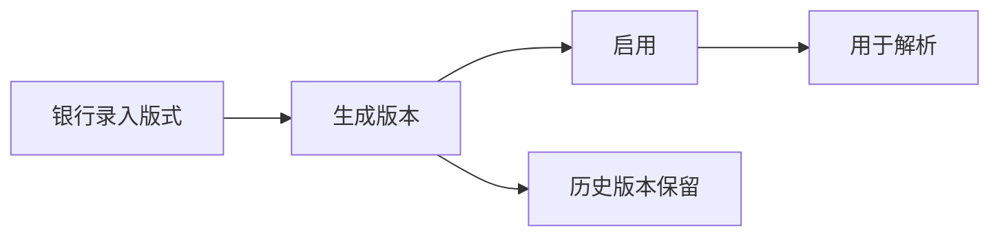

| 动作 | 谁做 | 说明 |
| --- | --- | --- |
| 录入 | 银行模板管理员 | 提供字段与坐标映射 |
| 生成版本 | 系统 | 每次录入产生新版本，只增不改 |
| 启用 | 银行 | 新版本启用后用于后续解析 |
| 历史保留 | 系统 | 旧版本永久保留，供历史月份解析 |

平台不采集模板的解析表现，不做灰度、不做回滚判断。某版式若不适用，由银行自行更新；平台只负责按当前启用版本执行。

#### 2.2.6 批量筛查

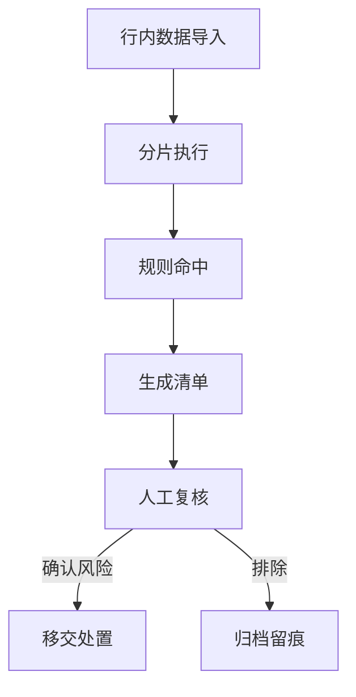

服务资金交易安全、反电诈与反洗钱三类场景。平台只出清单，不执行冻结或报送——处置动作由行内系统与业务人员承担，这是边界，不是能力不足。

#### 2.2.7 阈值与结论

真实性核验给出的是**事实与证据**，阈值判定给出的是**提示与结论**，两件事分开做、分开记版本。

| 项 | 谁定 | 能不能改 | 记什么版本 |
| --- | --- | --- | --- |
| 五态真伪结论 | 四层核验结果 | 不能改，事实就是事实 | 无 |
| 阈值项与默认值 | 系统发布自带 | 银行可改 | threshold_version |
| 指标口径 | PM/PD 与银行共定 | 可改，只能新增版本 | metric_set_version + caliber_version |

默认阈值示例：债务收入比 50%、收入稳定性 0.5、最近 30 天最低余额低于月供 1 倍、网贷平台数 3 个、涉赌命中 1 笔、夜间交易占比 10%。

三条规则：

1. 阈值只影响「提示是否触发」，**不影响真伪结论**——材料真假由核验决定，不由阈值决定。
2. 改了阈值，新报告用新版本重算，**老报告不重写**，仍按当时版本解释。
3. 报告里必须能查到用了哪一版阈值，否则审批人无法解释为什么结论变了。

### 2.3 技术架构图

#### 2.3.1 分层架构

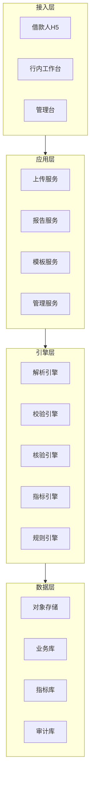

四层单向依赖，下层不反向调用上层。接入层不做业务判断，应用层不做算法计算，引擎层不感知界面，这三条是硬约束，越界会直接导致后续无法替换。

分层原则：接入层不写业务判断，应用层不做算法计算，引擎层不感知界面。

#### 2.3.2 部署拓扑

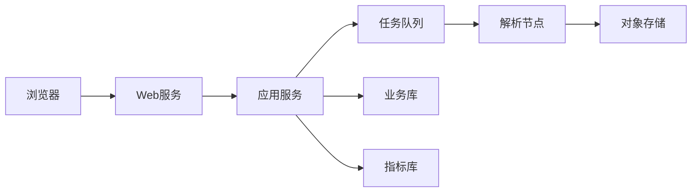

单机或少量节点部署，不引入反向代理与负载均衡。课程项目的并发量远达不到需要它们的程度，加了只会增加部署复杂度与排障成本；真要上生产时再补这一层，不影响现有结构。

外网上传与行内数据导入走不同入口，中间件与存储都在内网。解析节点可水平扩展，因为解析是全链路最耗时的环节。

### 2.4 时序决策图

本节只放时序图。图中的 alt 块就是该环节真正做出的决策，判据在第二章已说明，此处只标注决策发生在哪一步、由谁拍板。

#### 2.4.1 上传与合规检验

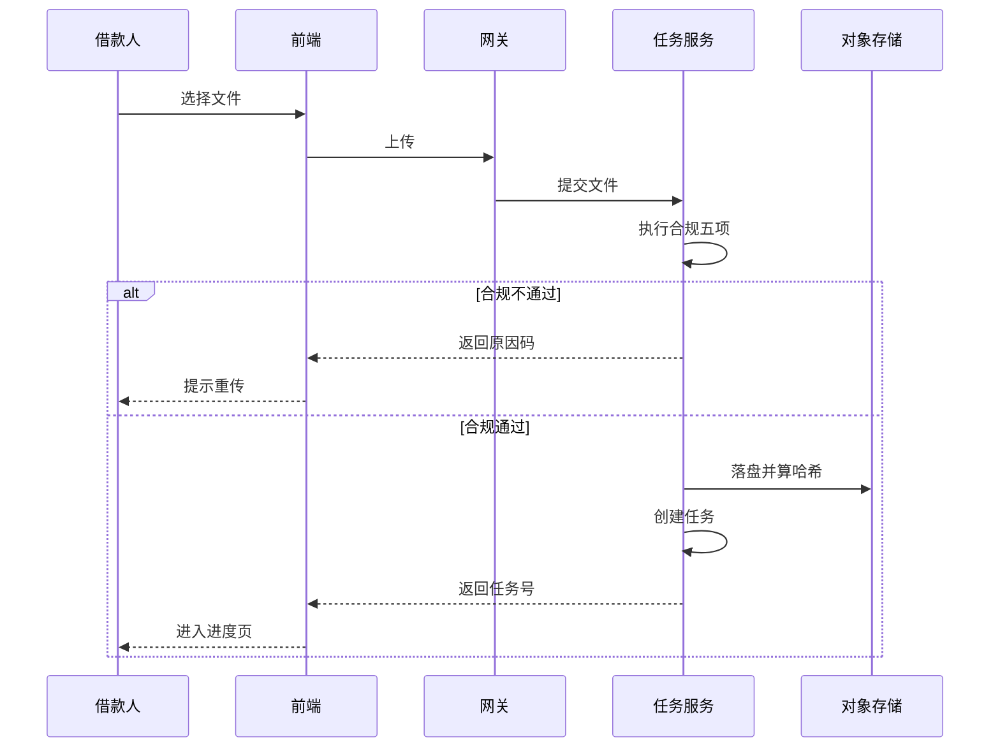

决策点是合规五项的合并判断，全部在任务服务内完成，前端只负责展示原因码。

#### 2.4.2 解析与自检

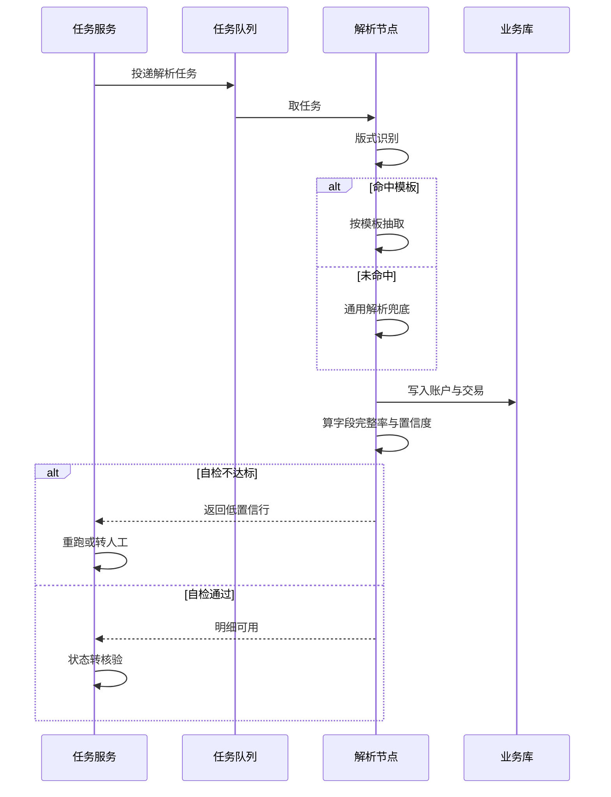

两个决策点：模板命中与否只影响抽取方式；自检是否达标决定任务继续还是返工。自检看的是字段完整率、平均置信度、低置信行占比三项，纯工程指标，与材料真假无关。

#### 2.4.3 核验与报告生成

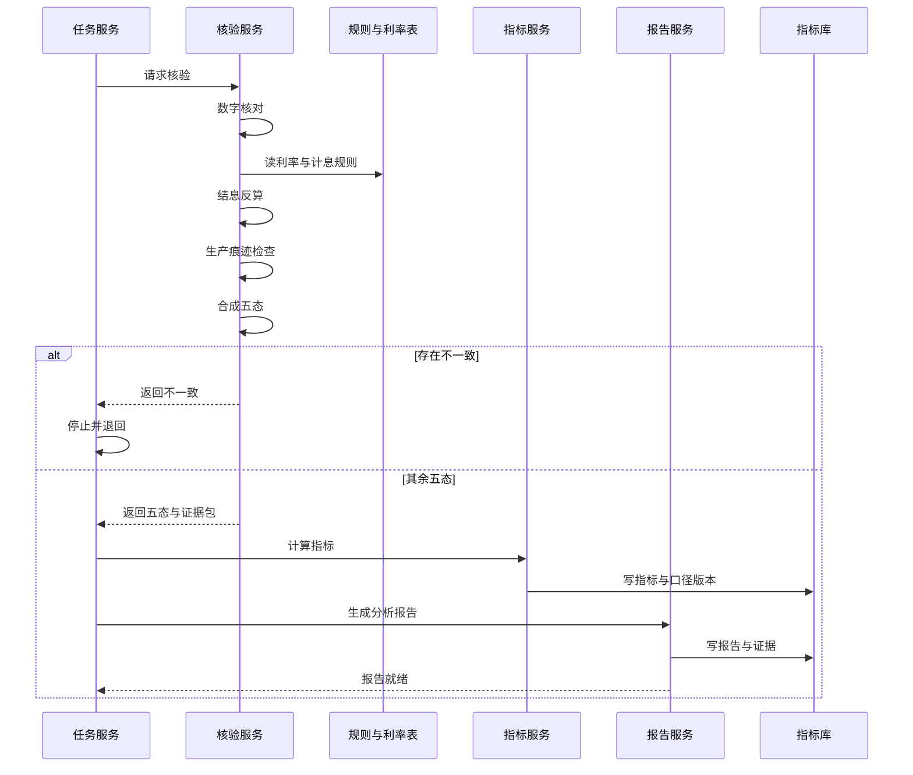

核验内部三步串行：先数字核对，再结息反算，最后生产痕迹。三步都对同一批数据，但信息源不同——第一步只用文件自己，第二步引入银行利率，第三步看文件的生成过程。

决策点是合成的五态，其中只有「存在不一致」中断流程。其余三种都进入报告生成，差别在表述。

#### 2.4.4 报告导出与留痕

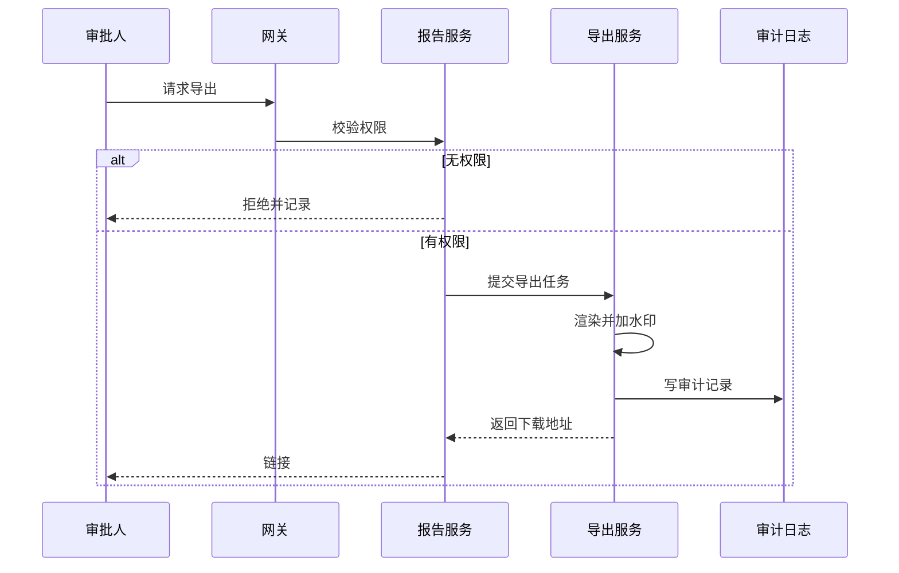

决策点是权限校验，在服务端完成。导出必须异步且先写审计再给地址，否则无法回答「谁在什么时候导出了哪一版」这个审计问题。

#### 2.4.5 申诉复核

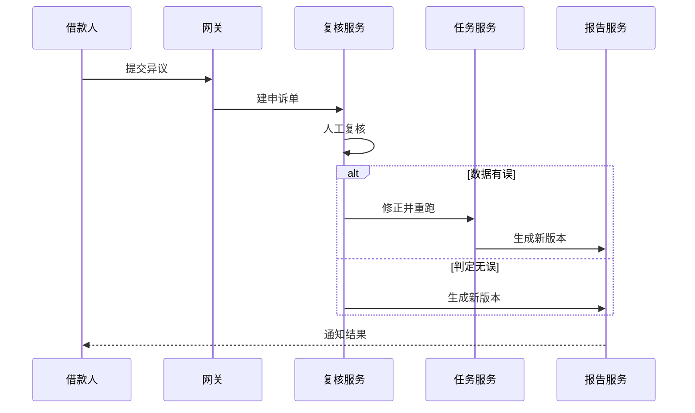

无论复核结论如何都生成新版本，原版本保留。这是申诉机制能成立的前提——否则改过没有说不清。

#### 2.4.6 批量筛查

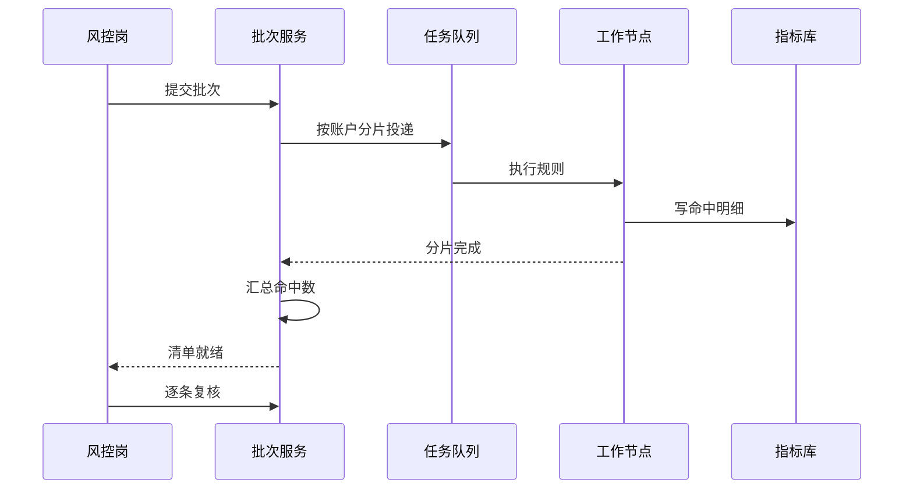

批量与在线分析共用规则引擎，差别只在调度方式：批量按账户分片、无文件入口、不生成报告，只出清单。

#### 2.4.7 模板更新

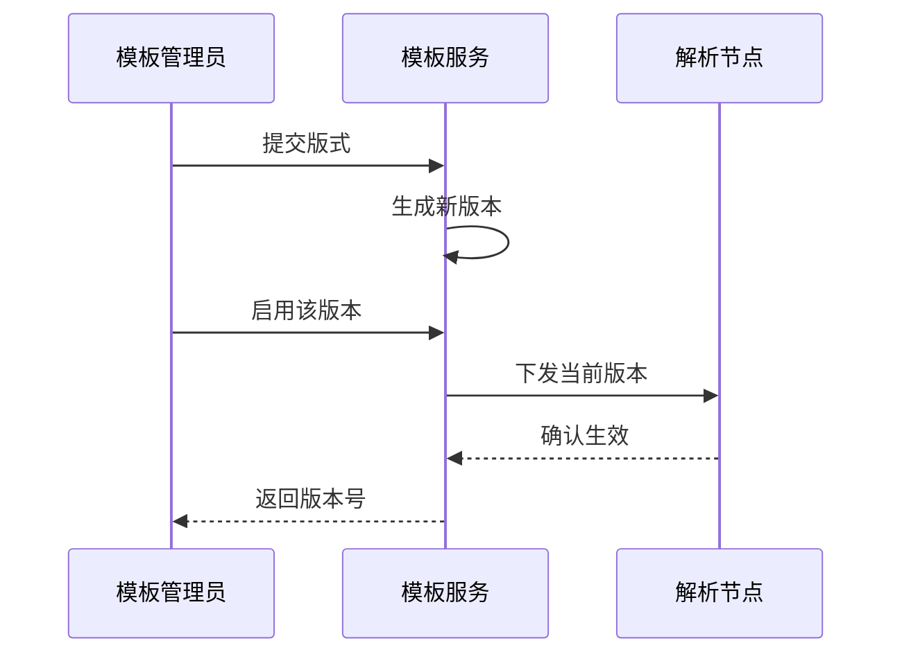

只有版本管理：录入生成新版本、银行启用、下发到解析节点。没有灰度、没有成功率采集、没有自动告警与回滚。旧版本不删除，历史月份仍可用当时版本解析。

### 2.5 数据模型设计

#### 2.5.1 设计原则

| 原则 | 做法 |
| --- | --- |
| 文件与任务分离 | 文件按哈希唯一，任务只引用，重跑不复制文件 |
| 业务数据快照化 | 账户、指标、报告为时点快照，可复现优先于省存储 |
| 从属明细不入表 | 校验结论、报告证据、批次命中存为 JSON 字段，不单独建表 |

不做的四件事：万能 EAV 表（近百指标会拖垮查询）、事件溯源（审计日志足够）、多租户隔离（单一银行定制）、全表软删除（无恢复需求）。

#### 2.5.2 实体关系

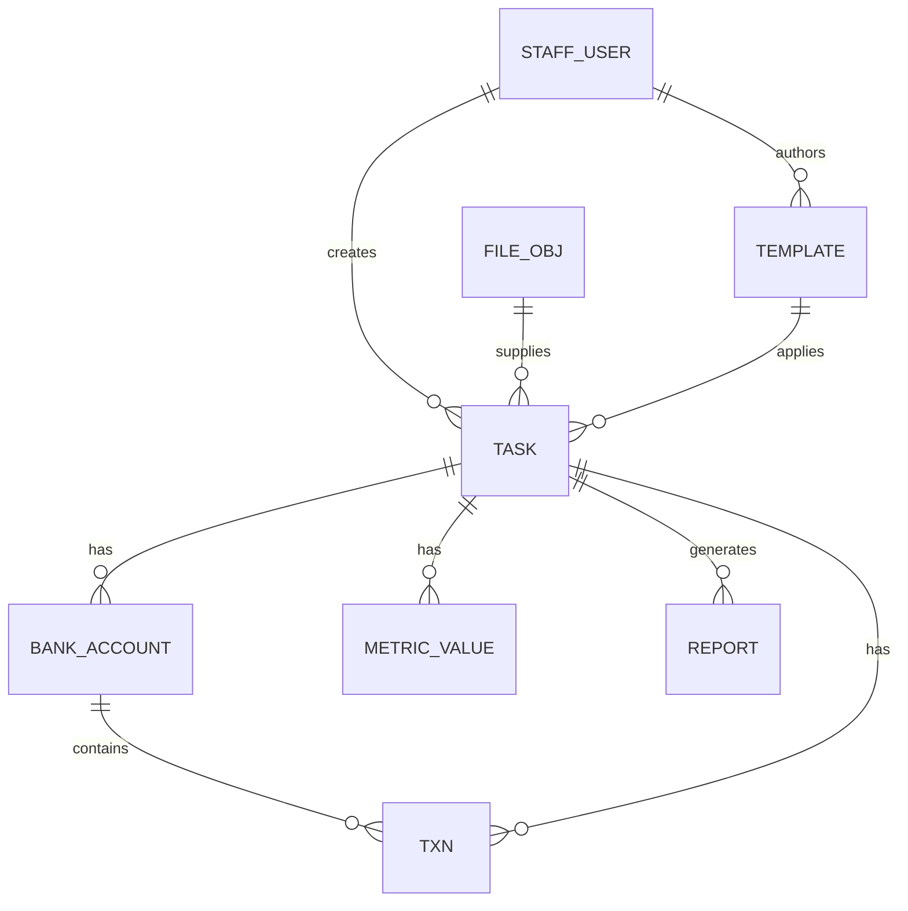

十张表，三个库：

| 库 | 表 |
| --- | --- |
| 业务库 | staff_user、file_obj、task、bank_account、txn、template、rule |

| 指标与报告库 | metric_value、report |
| 审计库 | audit_log |

三类载体统一走同一套表，靠 file_obj.carrier 与 task.carrier 区分；OCR 中间结果与利率表暂以样本数据承载，二期评估是否建表。

跨库不建外键，靠 task_id 逻辑关联。

#### 2.5.3 表说明

**staff_user 员工账号** — 银行侧登录与权限主体，借款人不是系统账号。

| 字段 | 类型 | 说明 |
| --- | --- | --- |
| id | bigint | 主键 |
| name | varchar | 姓名 |
| role | varchar | 审批 / 模板 / 运营 / 系统 |
| dept | varchar | 部门 |
| status | tinyint | 1 启用 0 停用 |
| created_at | datetime | 创建时间 |

**file_obj 文件** — 一份上传文件，按内容哈希去重。

| 字段 | 类型 | 说明 |
| --- | --- | --- |
| id | bigint | 主键 |
| sha256 | char | 文件指纹，唯一 |
| pages | int | 页数 |
| mime | varchar | application/pdf、image/jpeg、image/png |
| carrier | varchar | electronic / image / screenshot，服务端判定 |
| width | int | 图片宽，PDF 为空 |
| height | int | 图片高，PDF 为空 |
| has_text_layer | tinyint | 是否含可提取文字层 |
| storage_path | varchar | 对象存储路径 |
| uploaded_at | datetime | 上传时间 |

**task 分析任务** — 一次分析的全程记录，系统的主实体。

| 字段 | 类型 | 说明 |
| --- | --- | --- |
| id | bigint | 主键 |
| biz_no | varchar | 业务号，唯一 |
| task_type | varchar | credit 授信 / batch 批量筛查 |
| channel | varchar | upload 上传 / import 导入 |
| file_id | bigint | 引用文件，批量为空 |
| template_id | bigint | 使用的模板，批量为空 |
| template_version | int | 当时版本，快照 |
| applicant_name | varchar | 借款人姓名 |
| status | varchar | 见 2.4 状态机 |
| fail_code | varchar | 失败原因码 |
| check_result | json | 四项校验结论与失败行号 |
| period_start | date | 批量数据起始日，授信为空 |
| period_end | date | 批量数据截止日 |
| hits | json | 批量命中明细，授信为空 |
| created_at | datetime | 创建时间 |
| finished_at | datetime | 完成时间 |

**bank_account 流水账户** — 被分析对象，从文件里抽出并随任务固化，不是登录账号。

| 字段 | 类型 | 说明 |
| --- | --- | --- |
| id | bigint | 主键 |
| task_id | bigint | 所属任务 |
| account_no | varchar | 银行账号，按需脱敏 |
| bank_name | varchar | 开户行 |
| period_start | date | 期初日期 |
| period_end | date | 期末日期 |
| opening_balance | decimal | 期初余额 |
| closing_balance | decimal | 期末余额 |

**txn 交易明细** — 证据回溯的最小单位，全库最大的表。

| 字段 | 类型 | 说明 |
| --- | --- | --- |
| id | bigint | 主键 |
| task_id | bigint | 所属任务，冗余免 join |
| account_id | bigint | 所属账户 |
| txn_date | date | 交易日期 |
| direction | tinyint | 1 入账 0 出账 |
| amount | decimal | 金额，恒为正 |
| balance | decimal | 交易后余额 |
| summary | varchar | 摘要 |
| counterparty_name | varchar | 对手方名称 |
| page_no | int | 原始页码，证据定位 |
| coord_x | decimal | 框选横向坐标，相对比例 0–1 |
| coord_y | decimal | 框选纵向坐标，相对比例 0–1 |
| confidence | decimal | 该行抽取置信度，用于失败归因 |
| drop_reason | varchar | 剔除原因，空表示参与指标计算 |

**metric_value 指标** — 指标名与指标值存在同一行，报告直接按行呈现。

| 字段 | 类型 | 说明 |
| --- | --- | --- |
| id | bigint | 主键 |
| task_id | bigint | 所属任务 |
| metric_code | varchar | 指标编码 |
| metric_name | varchar | 指标中文名，随值一起存 |
| value_num | decimal | 指标值 |
| unit | varchar | 单位，如元、笔、百分比 |
| note | varchar | 口径说明，随值一起呈现 |
| caliber_version | int | 口径版本，必填 |

**report 分析报告** — 仅银行侧可见，只增不改。

| 字段 | 类型 | 说明 |
| --- | --- | --- |
| id | bigint | 主键 |
| task_id | bigint | 所属任务 |
| version | int | 版本号，只增不改 |
| carrier | varchar | 电子件 / 影像件 / 截图件 |
| verdict | varchar | 五态结论：未发现异常 / 存在不一致 / 余额可疑 / 来源可疑 / 无法判定 |
| metric_set_version | int | 指标集版本 |
| threshold_version | int | 结论所用阈值版本 |
| conclusions | json | 按阈值判出的提示项与取值 |
| limitations | json | 核验受限说明，影像件与截图件必填 |
| evidence | json | 证据数组，含交易与规则 |
| created_at | datetime | 生成时间 |

**template 版式模板** — 银行提供的版式配置，只做版本管理。

| 字段 | 类型 | 说明 |
| --- | --- | --- |
| id | bigint | 主键 |
| bank_code | varchar | 银行标识 |
| version | int | 版本，只增不改 |
| status | varchar | 草稿 / 启用 / 停用 |
| field_map | json | 字段与坐标映射 |
| created_by | bigint | 录入人 |
| created_at | datetime | 创建时间 |

**rule 风控规则** — 校验与指标的判定标准，版本化。

| 字段 | 类型 | 说明 |
| --- | --- | --- |
| id | bigint | 主键 |
| rule_code | varchar | 规则编码，唯一 |
| category | varchar | 校验 / 行为 / 对手方 / 摘要 |
| expr | text | 条件表达式 |
| threshold | json | 阈值参数 |
| version | int | 版本，只增不改 |
| status | varchar | 草稿 / 启用 / 停用 |

**audit_log 审计日志** — 只追加，用于责任追溯。

| 字段 | 类型 | 说明 |
| --- | --- | --- |
| id | bigint | 主键 |
| actor_id | bigint | 操作人，系统为 0 |
| action | varchar | 动作，如 report.export |
| object_type | varchar | 对象类型 |
| object_id | bigint | 对象主键 |
| created_at | datetime | 操作时间 |

### 2.6 API 接口设计

#### 2.6.1 通用约定

| 项 | 约定 |
| --- | --- |
| 基址 | /api/v1 |
| 鉴权 | 登录颁发会话令牌，请求头携带 |
| 返回结构 | code、message、data 三段，HTTP 状态码与 code 分离 |
| 重复提交 | 创建任务以文件哈希判重，重复提交返回原任务号 |
| 分页 | page 与 size，默认 20，上限 100 |
| 时间 | ISO 8601，统一东八区 |

#### 2.6.2 接口分组

**任务类**

| 接口 | 用途 | 约束 |
| --- | --- | --- |
| POST /tasks | 创建授信任务 | task_type 为 credit，以文件哈希判重 |
| GET /tasks/{id} | 查询进度 | 轮询间隔不短于 1 秒 |
| POST /tasks/{id}/retry | 重跑解析 | 仅失败态可调用 |
| POST /tasks/{id}/supplement | 补传材料 | 仅待补传态可调用 |

**报告类**

| 接口 | 用途 | 约束 |
| --- | --- | --- |
| GET /tasks/{id}/reports | 报告列表 | 按角色过滤可见范围 |
| GET /reports/{id} | 报告详情 | 仅银行侧角色可访问 |
| GET /reports/{id}/evidences | 证据列表 | 每项含页码与坐标 |
| POST /reports/{id}/export | 申请导出 | 异步，写审计后返回地址 |

**模板与规则类**

| 接口 | 用途 | 约束 |
| --- | --- | --- |
| GET /templates | 模板列表 | 支持银行与状态过滤 |
| POST /templates | 提交标注 | 由银行侧提交，平台不校验内容 |
| POST /templates/{id}/publish | 启用版本 | 银行操作，指定生效时间 |
| GET /rules | 规则列表 | 含版本与状态 |
| PUT /rules/{id} | 修改规则 | 生成新版本，不覆盖 |

**批量与管理类**

| 接口 | 用途 | 约束 |
| --- | --- | --- |
| POST /tasks | 创建批量任务 | task_type 为 batch，仅行内通道 |
| GET /tasks/{id}/hits | 命中清单 | 仅 batch 任务，分页并按规则筛选 |
| PUT /tasks/{id}/hits/{hitId} | 复核命中 | 记录复核人与结论 |
| GET /dashboard/metrics | 看板数据 | 聚合查询，缓存 5 分钟 |

#### 2.6.3 错误码

统一错误码，前端据此决定提示文案与下一步动作：

| 码 | 含义 | 前端动作 |
| --- | --- | --- |
| E_FORMAT | 不是 PDF | 提示重新选择 |
| E_BROKEN | 文件损坏 | 提示重新导出 |
| E_ENCRYPT | 无法解密 | 提示输入口令 |
| E_IMAGE_LOWQ | 图片分辨率过低 | 提示重新拍摄或导出 |
| E_IMAGE_BLUR | 模糊、倾斜或反光遮挡 | 指出哪一处看不清 |
| E_MULTI | 多银行混装 | 提示按行拆分 |
| E_CHECK | 四项校验不通过 | 定位到失败行 |
| E_STATE | 当前状态不允许 | 刷新后重试 |
| E_LIMIT | 超出页数或体积 | 提示拆分 |

#### 2.6.4 两个关键接口的报文

创建任务：

```json
{
  "file_hash": "9f2c...",
  "applicant_name": "张三",
  "applicant_id_hash": "7b1e..."
}
```

```json
{
  "code": 0,
  "message": "ok",
  "data": {
    "task_no": "T20261024001",
    "status": "compliance_checking"
  }
}
```

导出申请：

```json
{
  "report_id": 1024,
  "format": "pdf",
  "watermark": true
}
```

```json
{
  "code": 0,
  "message": "ok",
  "data": {
    "export_id": 88,
    "status": "pending",
    "download_url": null
  }
}
```

导出是异步的：第一次只返回任务号，前端轮询 export_id 的状态，完成后 download_url 才有值。

---

## 3. 前端交互设计

### 3.1 页面清单

借款人端三个页面，银行端六个，不做登录注册页——借款人入口由行内渠道带入，员工走行内统一登录。

| 页面 | 角色 | 目标 | 主要组件 |
| --- | --- | --- | --- |
| 上传页 | 借款人 | 提交可用材料 | 拖拽区（PDF/JPG/PNG）、图片三关前置校验、载体提示、原因码提示、口令输入 |
| 进度页 | 借款人 | 知道还要多久 | 阶段条、预计时长、失败指引 |
| 借款人报告 | 借款人 | 看懂自己的流水 | 图表、术语说明、交易展开、申诉入口 |
| 任务列表 | 审批人 | 找到待办 | 筛选器、状态标签、批量操作 |
| 报告详情 | 审批人 | 复核并出意见 | 结论卡、证据联动、意见录入 |
| 导出中心 | 审批人 | 导出与追溯 | 导出记录、水印选项、审计提示 |
| 模板标注 | 模板管理员 | 补长尾版式 | 原件预览、框选层、样本对照 |
| 规则配置 | 运营 | 调阈值与灰度 | 规则列表、表达式编辑、版本对比 |
| 数据看板 | 运营 | 看运行状况 | 解析量趋势、失败分布、模板覆盖 |

### 3.2 页面流转

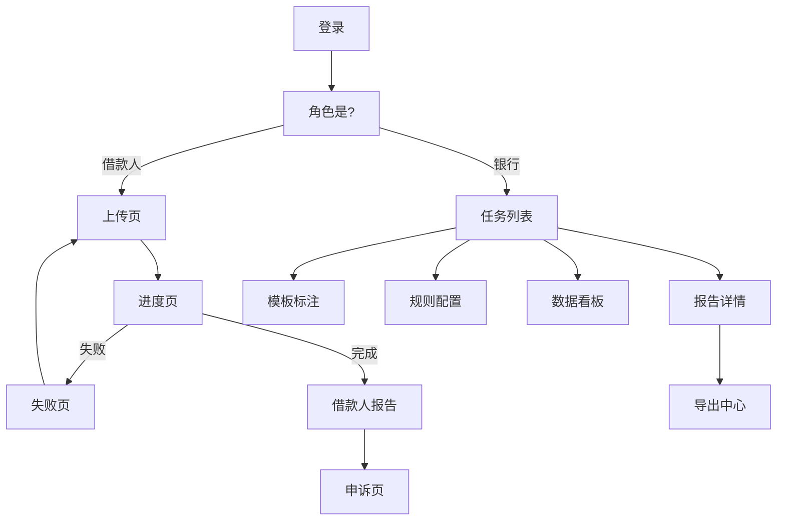

角色在登录时确定，之后不允许跨侧访问。借款人页面不存在工作台入口，银行页面也不返回任何借款人可见的措辞。

### 3.3 关键页面的状态设计

| 页面 | 状态 | 空态与失败态 |
| --- | --- | --- |
| 上传页 | 待选、上传中、校验中、退回 | 退回按原因码给可操作建议，不只显示错误码 |
| 进度页 | 排队、解析、校验、核验、完成 | 超过预计时长给兜底文案与客服入口 |
| 借款人报告 | 加载、就绪、部分缺失 | 缺失时标注缺哪一段，指标附说明 |
| 报告详情 | 就绪、证据加载中 | 证据加载失败不影响结论展示 |
| 模板标注 | 未标注、标注中、草稿、已发布 | 样本未上传不允许保存 |

### 3.4 错误码到文案

| 码 | 借款人看到的文案 | 银行端看到的文案 |
| --- | --- | --- |
| E_FORMAT | 请上传银行导出的 PDF 文件 | 文件类型不符 |
| E_IMAGE_LOWQ | 图片太小，关键信息看不清，请重新拍摄 | 短边不足 1000px |
| E_IMAGE_BLUR | 关键信息被遮挡或模糊，请重新拍摄 | 清晰度不达标 |
| E_CHECK | 文件内容有对不上的地方，请重新导出 | 四项校验失败，定位第 N 行 |
| E_LIMIT | 文件过大，请按月份拆分 | 超限，建议拆分后重传 |

同一错误对两类用户的表述必须不同：借款人要能照着做，审批人要能看到判断依据。

### 3.5 前端不做的判断

| 不做 | 原因 |
| --- | --- |
| 判断文件是否合规 | 需要读文件结构，属服务端职责 |
| 计算指标 | 口径必须统一，前端算会导致两处不一致 |
| 决定报告可见字段 | 权限与脱敏必须由服务端裁决 |
| 拼装证据链接 | 页码与坐标由服务端给出，前端只负责跳转 |

前端只做展示与采集，所有判断回到服务端。这条边界如果破了，脱敏和审计都会失效。

### 3.6 组件复用

| 组件 | 用在 | 说明 |
| --- | --- | --- |
| 阶段条 | 进度页、报告详情 | 同一套状态映射 |
| 原因码提示卡 | 上传页、失败页 | 文案表统一维护 |
| 证据联动器 | 报告详情、导出中心 | 结论与原文页的双向定位 |
| 图表容器 | 借款人报告、数据看板 | 统一主题与空态 |

## 4. 后端服务设计

### 4.1 业务能力职责边界

| 能力 | 负责 | 不负责 |
| --- | --- | --- |
| 上传与合规 | 文件接收、结构判断、任务创建 | 不判断内容真伪 |
| 解析 | 版式识别、字段抽取、行列重建 | 不做业务判断 |
| 校验 | 四项算术、完整性、定位 | 不决定是否出报告 |
| 核验 | 证据采集、五态判定 | 不做处置 |
| 指标与报告 | 指标计算、分层、报告渲染 | 不写审批意见 |

#### 4.1.1 服务协作

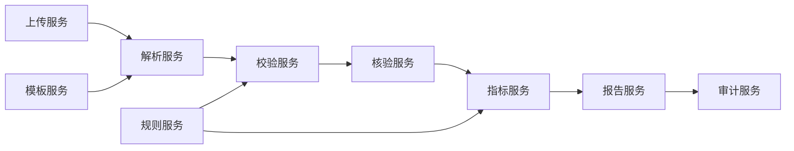

上传到报告的链路是单向的，模板服务与规则服务是横向依赖，审计服务不参与计算只接收写事件。这样审计出问题不会阻断主链路。

### 4.2 后端服务表

| 服务 | 输入 | 输出 | 性能要求 |
| --- | --- | --- | --- |
| 上传服务 | 文件流 | 任务号 | 任务创建 ≥100 QPS |
| 解析服务 | 合规文件 | 交易明细 | 10 页 300 笔 ≤5s |
| 校验服务 | 交易明细 | 校验结果与定位 | 同上 |
| 核验服务 | 明细与模板 | 五态与证据包 | 同上 |
| 指标服务 | 明细 | 指标集 | 单次 ≤1s |
| 报告服务 | 指标与证据 | 报告快照 | 单次 ≤2s |
| 模板服务 | 标注与样本 | 模板版本 | 发布 ≤5s |
| 批量筛查 | 批次数据 | 命中清单 | 按分片并发 |

---

## 5. 产品技术选型

| 层 | 选型 | 理由 |
| --- | --- | --- |
| 前端 | React 19.3 + Vite | 项目规范强制版本，端口 5173 |
| 图表 | ECharts | 金融图表成熟 |
| 后端 | FastAPI | 异步、契约清晰，端口 8000 |
| 任务队列 | 消息队列 + 工作节点 | 解析耗时长，需异步 |
| 存储 | 对象存储 + MySQL 8.4 | 文件与结构化数据分开；规范强制 MySQL，禁用 SQLite |
| 抽取（电子件与影像件） | 调行内 OCR/解析服务 API | 统一入口，返回坐标与置信度；不本地另搭识别 |
| 解析（影像件） | OCR 引擎 + 图像取证 | 图片无文字层，需识别并做像素级取证 |

---

## 6. 路线图与发布回看

| 阶段 | 交付 | 验收 |
| --- | --- | --- |
| 一 | 上传、合规检验、任务号 | 合法文件可追踪，不合规可读原因 |
| 二 | 解析、四项校验 | 首批银行版式跑通，笔数级准确率达标 |
| 三 | 完整性、补传、重传 | 缺失可定位可补 |
| 四 | 四层真实性核验 | 假件与账实不符可识别，结论可定位 |
| 五 | 真实性五态 | 结论可回溯至规则与交易 |
| 六 | 银行版报告、导出、留痕 | 可复核可追责 |
| 七 | 模板标注与发布 | 长尾版式可自建 |
| 八 | 看板、监控、规则、账号 | 可观测可运营 |

发布回看纪要模板：目标是否达成、未达成原因、对下一阶段的影响、需要甲方确认的事项。

---

## 7. 不做清单

| 不做 | 原因 |
| --- | --- |
| 实时交易拦截 | 需进入授权链路，属行内交易系统职责 |
| 全行级团伙识别 | 需跨客户数据与图计算平台 |
| 印章真伪鉴定 | 无数字签名时不具可验证性 |
| 自动授信决策 | 系统只提供证据，决策权在银行 |
| 风险判断与评分 | 只呈现指标与命中事实，不输出风险等级、评分或建议 |
| 多租户与对外 SaaS | 系统为单一银行定制 |
| 纸质件与截图 | 已纳入：影像件降级处理，截图件结论封顶 |

---

## 8. 附：需求追溯表

| 需求 | 需求分析条目 | 本文落点 |
| --- | --- | --- |
| 上传与合规检验 | 2.1 P0 | 2.2.1、2.2.3、4.1 |
| 解析与一致性校验 | 2.1 P1 | 2.2.3、2.2.4、2.4.2 |
| 完整性校验与补传 | 2.1 P2 | 2.2.3、2.4.2 |
| 文件层与内容层核验 | 2.1 P3 | 2.2.4、2.4.3 |
| 真实性五态 | 2.1 P4 | 2.2.4、2.4.3 |
| 银行版报告与留痕 | 3.1 P5 | 2.2.4、2.6 |
| 模板标注与发布 | 3.2 P6 | 2.2.5、2.5、2.4.7 |
| 看板与监控 | 3.3 P7 | 3、4.2 |
| 批量筛查 | 1.3 | 2.2.6、2.4.6 |
| 支撑业务治理 | 新增 | 2.2.2 |

---

## 9. 来源附录

1. 《需求说明文档》
2. 《需求分析文档》
3. 《资金流水分析与信贷风控技术调研》
4. 《资金流水分析产品工具调研分析（含竞品分析）》
5. 《智能风控项目_风控指标清单》（指标参考）

---

## 10. 待确认事项

| # | 事项 | 影响 |
| --- | --- | --- |
| 1 | 借款人上传页是否嵌入银行现有渠道 | 登录、实名、隐私政策归属 |
| 2 | 部署形态为行内机房还是专有云 | 架构与运维边界 |
| 3 | 利率表与计息规则表由谁维护 | 结息反算能否长期可用 |
| 4 | 指标口径的最终版本由谁签发 | 报告版本的一致性 |
| 5 | 批量筛查的数据授权范围 | 可筛查的账户与时段 |
